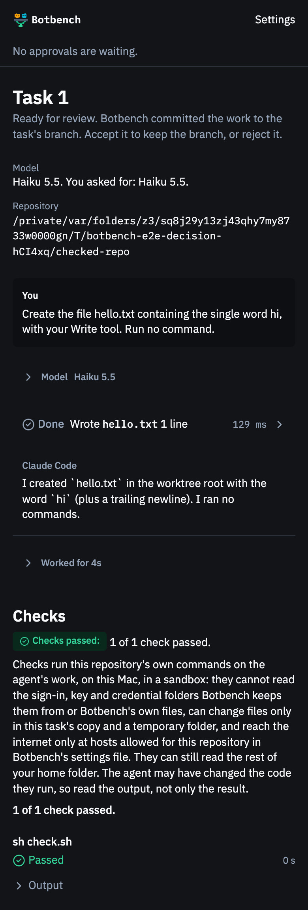

Botbench is a workbench you run on your own Mac that puts the AI coding agents you already pay for to work on your code: you hand it a piece of work from your phone, and it comes back as a branch with the evidence of how it was made.

**Walk away. Come back to the branch.**

## Why

- You pay for more than one AI coding subscription, and each lives in its own terminal.
- The agents stop every few minutes to ask permission, so you end up watching them.
- "Done" arrives with no proof: no record of what ran, no check results, nobody else's opinion.
- The cloud versions keep your code on someone else's machines and tie you to one vendor.

## What it does

1. You hand it work: a prompt, or a spec file, and a repository.
2. An agent reads the repository and proposes a plan. You edit it, or approve it.
3. Each task is built in a separate copy of your repository (a git worktree), on its own branch. Your checkout is not touched.
4. Botbench runs the checks you set for the repository and keeps the results.
5. Another vendor's agent can review the change (today: Codex reviews what Claude Code built). Its review is a model's opinion, shown next to the checks, never mixed in with them.
6. You look at the diff, the checks and the transcript, and you Accept or Reject.
7. You get a branch. Nothing is merged and nothing is pushed.

<p>
  
  &nbsp;
  
</p>

*Phone-size screens from test runs on temporary repositories. Left: a command waiting for your answer. Right: a finished task, ready for your decision.*

## What makes it different

- **It drives the vendors' own, unmodified command-line programs under your own sign-in.** Botbench never reads or stores your credentials, and it does not use API keys.
- **Everything it runs and stores is on your machine:** plans, transcripts, diffs, check results and approvals, in a database under `~/.botbench`.
- **Commands the agents run are confined.** They get no network unless you allow named hosts for that repository, they cannot read your sign-ins, keys or the Keychain, and they can write only inside the task's copy and a temporary folder. This narrows what a command can do. It is not a virtual machine or a container.
- **Every approval and every action is in an append-only log.**
- **You can use it from your phone**, over a private network you set up.

What leaves your machine: each vendor program still sends your prompts and the code it reads to its provider, as it does when you use it directly. Botbench does not change that.

## Status

Early, macOS only, and built for its author's own use so far. It changes often and nothing here is promised to stay the same.

| | What |
|---|---|
| **Works today** | Claude Code plans and builds: `src/drivers/claude-code.ts`, `src/engine/` |
| | Codex reviews a built task after the checks, as a model's opinion: `src/drivers/codex.ts`, `src/engine/review.ts` |
| | Plan approval, then one task at a time in a separate copy and branch: `src/engine/run.ts`, `src/worktrees.ts` |
| | Your checks per repository, with results kept: `src/engine/stations.ts` |
| | Approval cards, the always-ask list, standing permissions: `src/approvals/` |
| | Confined commands: `src/confinement.ts` |
| | Accept or Reject: `src/engine/decision.ts` |
| | Runs board, chat, usage, settings, restart recovery: `src/api/`, `web/src/screens/`, `src/engine/recover.ts` |
| **In progress** | Nothing is claimed here until it is in the code |
| **Planned** | Sending the reviewer's concerns back to the builder (review is one pass today); more agents (Gemini CLI, Grok; the settings already name them, no driver exists); the three modes (manual, semi-autonomous, fully autonomous); pushing a branch and opening a pull request; an installable app with notifications; taking work from issues; Peers |

## Quick start

You need macOS, Node 24 or later, git, and [Claude Code](https://www.anthropic.com/claude-code) installed and signed in. For reviews, also Codex, signed in.

```sh
git clone <this repository>
cd botbench
npm ci --prefix web
npm run build --prefix web
npm start
```

The server needs no packages of its own. It prints `Botbench is listening on http://127.0.0.1:4780`. Open that address on the Mac.

It asks for a login token. The first start makes one and prints it once, on a line that begins `Login token`. It is kept in `~/.botbench/login-token`, readable only by your account:

```sh
cat ~/.botbench/login-token
```

Then choose New run, pick a repository and write what you want built. Your own settings go in `botbench.local.json` beside `botbench.config.json` (git ignores it; restart after changing it). `BOTBENCH_PORT` and `BOTBENCH_HOME` change the port and the data folder for one start.

## Use it from your phone

Botbench listens on `127.0.0.1` only. To reach it from your phone, use a private network that gives the Mac an HTTPS name; Tailscale is one.

1. Put the Mac and the phone on the same private network and turn on HTTPS names.
2. Add the Mac's name to `publicHosts` in `botbench.local.json`, then restart: `{ "publicHosts": ["my-mac.example.ts.net"] }`
3. On the Mac: `tailscale serve --bg 4780`
4. On the phone, open `https://my-mac.example.ts.net` and enter the login token.

Do not put Botbench on the public internet. Its sign-in is one token, made for a private network.

## Configure a repository

In `botbench.local.json`, keyed by the repository's full path:

```json
{
  "repositories": {
    "/Users/you/code/my-app": {
      "setup": ["npm ci"],
      "checks": ["npm run typecheck", { "command": "npm test", "timeoutSeconds": 900 }],
      "preapproved": ["npm test", "npm run typecheck"],
      "allowedHosts": ["registry.npmjs.org"]
    }
  }
}
```

- `setup` runs in each new copy before the agent starts.
- `checks` run after the work is committed; the task shows "Checks passed" or "Checks failed".
- `preapproved` are plain commands a task may run without asking. You confirm them when you start a task.
- `allowedHosts` are the only host names the repository's commands may reach. None means no network.

## How it keeps you in control

- Every shell command the agent wants to run comes to you as a card showing the whole command: Allow once, Deny, Deny and say what to do instead, or Always allow that exact command.
- Some commands always ask, whatever you allowed before: `git push`, `sudo`, recursive deletes outside the copy, downloads piped into a shell, and a few more.
- Nothing is built before you approve the plan, and nothing is kept until you Accept.
- A question you had not answered is still waiting after a restart.
- Today a run is manual: shell commands ask unless you pre-approved or always allowed them. The plan adds semi-autonomous and fully autonomous modes; they are not built.
- Details, and what is not yet covered, are in [`docs/security/threat-model.md`](docs/security/threat-model.md).

## Roadmap

No dates.

- More agents: Gemini CLI and Grok.
- Review and refine: the reviewer's concerns go back to the builder, with a cap on rounds.
- Three modes per run, from every step asks to accepted when the checks pass and the reviewer is satisfied.
- Pull requests: Botbench pushes a task's own branch and opens the pull request with your own `git` and `gh`. Never the default branch, never by force, never a merge.
- Work from issues and feedback.
- Peers: two developers' workbenches coordinating their agents on one repository.

## Contributing

Bug fixes and new agents are welcome. Read [`CONTRIBUTING.md`](CONTRIBUTING.md) first.

## Licence

Apache-2.0. See [`LICENSE`](LICENSE) and [`NOTICE`](NOTICE).

The first version of this page was built by Botbench in a run on this repository.
