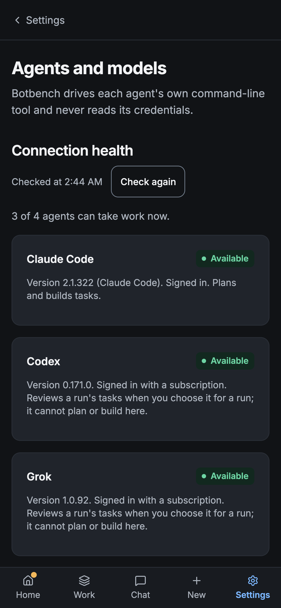

# Botbench

Botbench is a workbench you run on your own Mac. You give it a piece of coding work from a browser on the Mac or on your phone. It has Claude Code, the coding agent you already have, do the work in a separate copy of your repository, asks you before each shell command (or, in a run you made semi-autonomous or fully autonomous, lets the ones that run inside its sandbox go without asking), runs your repository's checks, can have Codex, Grok or Antigravity review the result, and hands back a git branch with the evidence: the diff, the transcript, the check results and each answer you gave. Nothing is ever merged. Nothing is pushed unless you chose, for a run, to have each accepted task opened as a pull request, or turned on claiming issues for a repository (an empty branch that tells other workbenches you started on an issue).

It is for one developer on macOS. It is early, and built so far for its author's own use. It does not replace your agents, it is not a hosted service, and it is not a security sandbox.

*Walk away. Come back to the branch.*

<p>
  
  &nbsp;
  
</p>

*From the quickstart below, at phone size. Left: Claude Code waits for your answer before running a command. Right: the finished task with its checks, changed files and branch, waiting for your decision.*

## How a piece of work goes

1. You start a **run** (a prompt or a spec file, and a repository) or a single **task** (a prompt and a repository).
2. For a run, Claude Code reads the repository and proposes a plan of tasks. You edit it or approve it. Nothing is built before you approve, unless you made the run fully autonomous: then the plan is approved as the planner gave it.
3. Each task is built in a separate copy of your repository (a git worktree) on its own branch, `botbench/run-<n>/task-<n>`. Your own files and branch are not touched.
4. Every shell command the agent wants to run waits for your answer, unless it starts with the words of a command you allowed for the task or run (further arguments may follow), or is exactly one you chose Always allow for. In a semi-autonomous or fully autonomous run a command that runs inside the sandbox goes without asking; a short list of dangerous commands always asks (and in a fully autonomous run is refused instead).
5. Botbench commits the work, runs the checks you set for the repository, and keeps their output. A build that changed no file stops there, as failed, for you to resume or discard. If you chose a reviewer (Codex, Grok or Antigravity), it then reads the change; with concerns, Claude Code is given the review and makes a round of fixes, up to the run's limit, and the checks and the review run again. A review is shown as a model's opinion, next to the checks and never counted as one.
6. You read the diff, the checks and the transcript, and you Accept (the branch is kept, and opened as a pull request if the run says so) or Reject (you choose whether to keep the branch). A fully autonomous run accepts a task without you only when every check passed, the review is satisfied or there is none, and nothing was refused during the task; otherwise it waits for you.

## Is it for you?

**Use it if** you work on a Mac, use Claude Code with your own sign-in, and want to hand it work and come back to a reviewable branch instead of watching a terminal; if you want each shell command an agent runs to wait for your yes (or, run by run, to go unasked inside a sandbox), with a record of what ran; and if you want the transcripts, approvals and check results kept on your machine.

**Don't use it if:**

- **You are on Windows or Linux.** Agents are only started on macOS: the confinement below relies on macOS's sandbox.
- **You want a hosted service or a team tool.** It is one person's workbench on one Mac, behind a single login token. There are no accounts.
- **You need a hard security boundary for code you do not trust.** Commands an agent runs are confined by the macOS sandbox: they cannot read your sign-ins, keys or Keychain, reach no network except hosts you allow for that repository, and can write only in the task's copy and a temporary folder. It is not a virtual machine or a container. Claude Code itself runs outside it with your rights. Your repository's setup and check commands, which run the code the agent wrote, can still read your home folder outside the protected places. A test server those commands start on all network addresses, rather than only on 127.0.0.1, can be reached from other machines on your network while it runs, as macOS's sandbox cannot tell the two apart; the macOS firewall blocks that. Point Botbench only at repositories you trust. The exact limits are in the [threat model](docs/security/threat-model.md#confined-commands-u27).
- **You expect your code to stay on your Mac.** Claude Code, Codex, Grok and Antigravity send your prompts and the code they read to their providers (Anthropic, OpenAI, xAI and Google), as they do when you use them directly. Botbench does not change that.
- **You need it stable.** It changes often, and nothing here is promised to stay the same.

Whether your subscription's terms allow this kind of unattended use of the vendor's program is the vendor's decision. Check them before relying on it.

## What works today

| State | What | Where |
|---|---|---|
| **Works today** | Claude Code plans and builds; one task at a time, each in its own copy and branch | `src/drivers/claude-code.ts`, `src/engine/` |
| | Approval cards, commands allowed in advance, Always allow, and a list of dangerous commands that always ask | `src/approvals/` |
| | Confined commands, per-repository checks and setup commands | `src/confinement.ts`, `src/engine/stations.ts` |
| | Codex, Grok or Antigravity as reviewer of a run's tasks (reviews only; they cannot plan or build), and rounds of fixes in which Claude Code answers the review | `src/drivers/codex.ts`, `src/drivers/grok.ts`, `src/drivers/antigravity.ts`, `src/engine/review.ts`, `src/engine/refine.ts` |
| | Three modes per run: manual, semi-autonomous, fully autonomous | `src/engine/modes.ts`, `src/approvals/gate.ts` |
| | Opening a pull request for an accepted task, with your own `git` and `gh`; never merged | `src/engine/delivery.ts`, `src/github.ts` |
| | Accept or Reject; runs board, chat, usage, settings; recovery after a restart | `src/engine/`, `web/src/screens/` |
| | Starting work from one message box on the home screen; dictating into it, transcribed on the Mac; staying signed in on a device, with a list of signed-in devices | `web/src/screens/turn.tsx`, `src/dictation/`, `src/api/auth.ts` |
| | A run started from one GitHub issue you name: read with your own `gh`, shown to you as plain text, given to the planner and builder as text from outside (no command allowed in advance or always allowed for that run, no network unless you allow it, never fully autonomous); its pull request closes the issue. Nothing is posted to GitHub | `src/engine/intake.ts`, `src/github.ts` |
| | Named workbenches: each installation's task branches carry its name (`botbench/<workbench>/run-N/task-M`, set in Settings), and the Work screen, the composer and the task screen show, read only, other workbenches' open pull requests and pushed branches on the same remote. With `"claimIssues": true` for a repository in the settings file (off by default), a run started from an issue pushes an empty branch at once so the others see you started on it, and deletes it if the run ends without a pull request; when two workbenches claim one issue, the later one stops and opens no pull request, unless its owner took over an old claim | `src/workbench.ts`, `src/engine/peers.ts`, `src/engine/claims.ts` |
| **In the code, not confirmed on a real iPhone** | Adding Botbench to the phone's Home Screen, and notifications when an approval is waiting or a task is ready | `src/push.ts`, `web/public/` |
| **Planned, not in this code** | Watching a repository for new issues, and posting back to them; one container per task; two developers' workbenches working on one repository | [the plan](docs/plans/2026-11-21-2234-feat-botbench-software-factory-plan.md) |

## Quickstart

About ten minutes. It ends with a branch made by Claude Code in a practice repository, and costs one short Claude Code turn on your subscription.

**You need:** macOS; Node 24 or later; git, set up so you can commit; [Claude Code](https://www.anthropic.com/claude-code) 2.1.322 or later, installed and signed in (`claude --version`, `claude auth status`). Codex 0.171.0 or later only if you want reviews. The repository is private for now: you need access to it on GitHub to clone it.

**1. Get it and build the screens.** The server itself has nothing to install.

```sh
git clone https://github.com/jon-lange/botbench.git
cd botbench
npm ci --prefix web
npm run build --prefix web
```

**2. Start it.** Leave this terminal open; Ctrl+C stops Botbench.

```sh
npm start
```

It prints:

```
Botbench is listening on http://127.0.0.1:4780
Login token (shown this once, kept in /Users/you/.botbench/login-token): …
```

The token is printed only on the first start. Later, read it with `cat ~/.botbench/login-token`. To use another port or data folder for one start, set `BOTBENCH_PORT` and `BOTBENCH_HOME`, for example `BOTBENCH_PORT=4781 BOTBENCH_HOME=/tmp/botbench-trial npm start`.

**3. Sign in.** Open http://127.0.0.1:4780 in a browser on the Mac, paste the token and choose Sign in. You arrive on Chat: an empty screen above the message box. Under Settings (the gear, top right), Agents lists Claude Code as Available. If it says Signed out, run `claude auth login` in a terminal.



**4. Make a practice repository**, in a second terminal:

```sh
mkdir ~/botbench-try && cd ~/botbench-try
git init
echo "# Try" > README.md
git add README.md && git commit -m "Start"
pwd
```

**5. Start a task.** In Botbench, on Chat, press + (Add context) under the message box and choose Repository, then Another folder…. Paste the path `pwd` printed into Folder path; when it reads "Usable git repository.", close the sheet with the X. What to do is already One task. The box now reads "Describe the task"; write:

```
Add a file hello.txt that says hello, then run ls to show that it is there.
```

Any model will do; the chip under the box shows the one in use, and a small one such as Haiku is enough (tap the chip to change it). Choose Send.

**6. Answer the approval.** Within a minute the task shows a card, "Claude Code asks to run a command", with the command it wants to run (the model chooses the exact command). Choose Allow once.

**7. Review and accept.** The task reads Ready for review, with "No checks are set up for this repository", `hello.txt` under Changed files, and its branch, for example `botbench/run-1/task-1`. Choose Accept. Botbench keeps the branch and removes the task's copy.

**8. See the branch** in the practice repository:

```sh
git branch
git show --stat botbench/run-1/task-1
```

The new branch holds one commit by Botbench that adds `hello.txt`. Your own branch is unchanged, and `git status` shows nothing to commit.

**Clean up:** Ctrl+C in the first terminal, then `rm -rf ~/botbench-try`. Botbench keeps its database and login token in `~/.botbench`; delete that folder only if you want to start again from nothing.

From here, try Work → New run on a real repository (or, in Add context, What to do → Plan a run): Claude Code proposes a plan first, and you can add checks and a reviewer.

## Configure a repository

Your settings go in `botbench.local.json` in the `botbench` folder (git ignores it), keyed by the repository's full path. Restart Botbench after changing it. A wrong setting stops the start with a message that names the file and the setting.

```json
{
  "repositories": {
    "/Users/you/code/my-app": {
      "setup": ["npm ci"],
      "checks": ["npm run typecheck", { "command": "npm test", "timeoutSeconds": 900 }],
      "preapproved": ["npm test", "npm run typecheck"],
      "allowedHosts": ["registry.npmjs.org"]
    }
  }
}
```

- `setup` runs in each new copy before the agent starts; a command that fails ends the task.
- `checks` run after the work is committed; the task shows "Checks passed" or "Checks failed". Each has a 10-minute limit unless you give `timeoutSeconds`.
- `preapproved` are commands a task may run without asking. They are offered when you start a task or run, and you confirm or edit them there.
- `allowedHosts` are the only host names the repository's commands may reach. Without it, no network.

The defaults are in [`botbench.config.json`](botbench.config.json). Every setting, including models per agent and your own additions to the always-ask list, is described in [`src/config.ts`](src/config.ts).

## Use it from your phone

Botbench listens on `127.0.0.1` only. To reach it from your phone, use a private network that gives the Mac an HTTPS name; Tailscale is one. This was not part of the tested quickstart.

1. Put the Mac and the phone on the same private network and turn on HTTPS names.
2. Add the Mac's name to `botbench.local.json` and restart: `{ "publicHosts": ["my-mac.example.ts.net"] }`
3. On the Mac: `tailscale serve --bg 4780`
4. On the phone, open `https://my-mac.example.ts.net` and sign in with the login token.

Do not put Botbench on the public internet. Its sign-in is one token, made for a private network.

## What leaves your Mac

- What each agent sends its provider: your prompts and the code it reads, as when you use it directly.
- If you turn on notifications for a device: a short encrypted notice, through Apple's or Google's push service, that an approval is waiting or a task is ready. Never a command, code or a file name.
- What a repository's commands send to the hosts you allowed for it in `allowedHosts` (none unless you set some). A run started from a GitHub issue reaches none of them unless you allow them for that run.
- If you start a run from a GitHub issue: your own `gh` asks GitHub for that one issue. It only reads; Botbench posts nothing back (no comment, label or close). A pull request it opens for such a run says "Closes #N".
- If you use it from your phone: the traffic between phone and Mac, over the private network you chose.
- Nothing else from Botbench itself. It drives the vendors' own, unmodified programs under your own sign-in. It never reads or stores your credentials and does not use API keys. Plans, transcripts, diffs, check results, approvals and the append-only action log stay in a database in `~/.botbench`.

## Where to go next

| To | Go to |
|---|---|
| Understand what is protected and what is not | [`docs/security/threat-model.md`](docs/security/threat-model.md) |
| Know why it drives the vendors' programs, and how secrets are kept from agents | [`docs/adr/`](docs/adr/) |
| Add another agent | [`CONTRIBUTING.md`, Adding an agent](CONTRIBUTING.md#adding-an-agent) |
| Contribute a fix, run the tests | [`CONTRIBUTING.md`](CONTRIBUTING.md) |
| Report a bug | [GitHub issues](https://github.com/jon-lange/botbench/issues), with what you did, what you expected and what Botbench printed |
| Report a security problem | Not in an issue. See [`CONTRIBUTING.md`, Reporting a security problem](CONTRIBUTING.md#reporting-a-security-problem) |
| See what is planned | [The plan](docs/plans/2026-11-21-2234-feat-botbench-software-factory-plan.md) |

## Licence

Apache License 2.0: [`LICENSE`](LICENSE). Files copied from other projects, and what the built screens bundle, are listed in [`NOTICE`](NOTICE).
