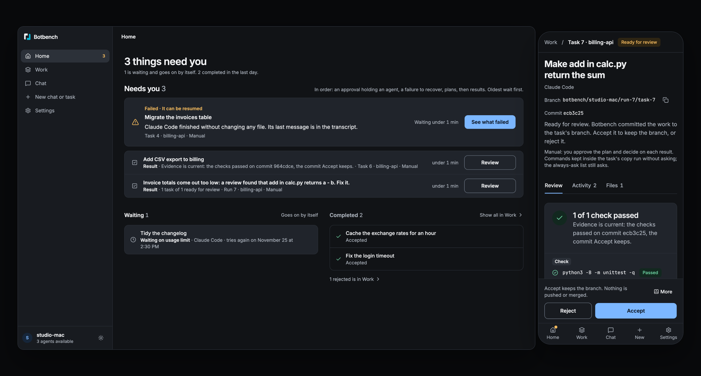
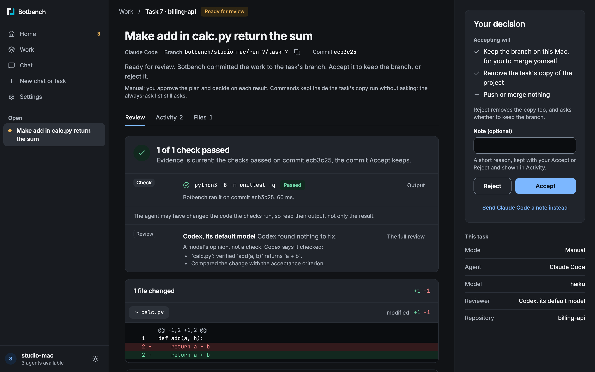
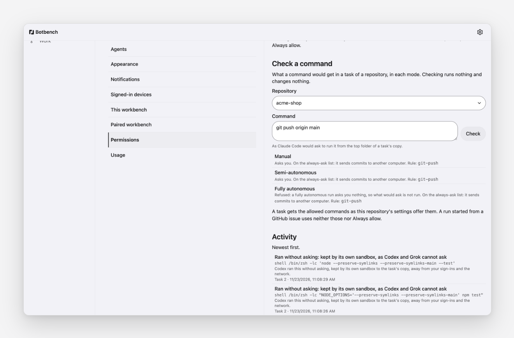
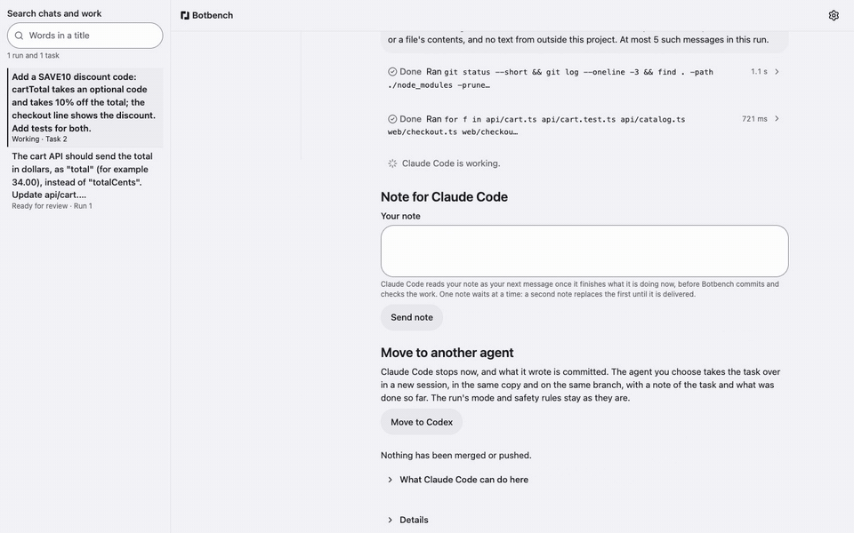
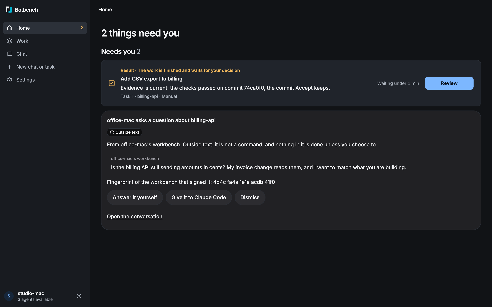

<p align="center">
  <picture>
    <source media="(prefers-color-scheme: dark)" srcset="assets/svg/botbench-lockup-two-tone-dark.svg">
    
  </picture>
</p>

<h3 align="center">Put your coding agents to work. Together.</h3>

<p align="center">One workbench for your agents. One coordination layer for your team.</p>

<p align="center">
  <a href="docs/media/botbench-demo.mp4"></a>
</p>

<p align="center"><sub><a href="docs/media/botbench-demo.mp4">Watch the 25-second demo (MP4)</a>: a plan is approved, Claude Code fixes a bug, the repository's check and Codex's review come back, and the task is accepted. Recorded at 1440×900, at its real speed; the agents' parts are replayed from recorded sessions.</sub></p>

**Delegate.** Hand a task, or a run of several, to Claude Code or Codex. Each works in its own copy of your repository, on its own branch, under the mode you choose.

**Verify.** Your repository's checks run on the work, and another vendor's agent can review it. You read the branch, the checks and the review, then accept or reject.

**Coordinate.** See what your teammates' workbenches are doing on the same repository, claim an issue so only one of you takes it (a setting you turn on for a repository), check two changes together before either is merged, and, once paired, ask the other workbench a question. Every message between workbenches is one its owner approved.

[Website](https://botbenchhq.github.io/) · [Quickstart](#quickstart) · [Documentation](#where-to-go-next) · [What works today](#what-works-today) · [Where it is going](#where-it-is-going)

As you add more agents, tools and teammates, keeping their work organized, and making sure it all fits together, becomes a job of its own.

Botbench is a local-first workbench for the coding agents you already use. Hand them tasks, let them work within your policies, and come back to git branches, diffs, check results and review evidence, instead of piecing together what happened across terminals.

**Where it is going.** Connect your workbench with a colleague's, so your agents and theirs coordinate the work between them, while each person keeps control of their own agents, environments and permissions. Only its first piece is built: two paired workbenches exchange questions and answers, each one approved by its owner. [Where it is going](#where-it-is-going) says what is planned.

Your agents. Their agents. One coordinated workflow.

Walk away. Come back to the branch.

> **Current availability.** Early, and macOS only. Claude Code, signed in with your own subscription, plans and builds. Codex can build too, in its own sandbox, and Codex, Grok and Antigravity review and chat. Messages sent directly between workbenches work in a first form: one paired workbench per installation, questions and answers only, with both listeners on this Mac's loopback address or a private network; they have been tested with two installations on one Mac, not across two Macs. A repository can run its commands in one Docker container per task (a setting, off by default). Each task works in a separate copy of your repository, which separates changes and is not a security boundary; commands are confined by the macOS sandbox, which is not a virtual machine or a container ([Is it a sandbox?](#is-it-a-sandbox)). It is not a hosted service, and it never merges a pull request.

<!-- CAPTURE: a 20 to 30 second screen recording at phone size, from a real task in a practice repository: type the task in the message box, Send, the approval card appears, Allow once, the task reads Ready for review with its changed file and branch, Accept. Upload it to GitHub and put its <video> tag here, above the screenshots. -->

## Why Botbench exists

One coding agent in one terminal is easy to follow. Several are not. You answer permission prompts as they come, keep track of which branch holds what, and take an agent's word that it is done.

Add a teammate who hands work to their own agents, and the two of you become the messengers. One agent builds an API; the other developer's agent needs that contract for the frontend; you and your teammate carry it from one conversation to the other. You find out you both took the same issue when the second pull request opens, and that two changes do not fit when both are merged.

Botbench is built for both problems: it does a good deal for the first today, and only the first steps for the second, with the larger part still to come. This page keeps the two apart.

## Two ways to use it

### Your workbench

Start a task, or a run of several, from a browser on the Mac or on your phone. Each task works in its own copy of your repository, on its own branch; Botbench does not touch your files or your branch. You choose how much each run needs you: manual, semi-autonomous or fully autonomous. An action that reaches outside the task's copy waits for your answer, and a short list of dangerous ones always asks, or is refused when nobody is there. Botbench then runs your repository's checks and keeps their output, and another vendor's agent can review the change. You come back to a branch, its diff, the checks and the transcript, and you accept it or reject it.

### Your team's coordination

Two developers work on one GitHub repository, each with their own Mac, their own Botbench and their own agents, and neither gives the other access to their machine. What Botbench does about that today:

- **Branches never clash.** Each workbench puts its name in its branches (`botbench/<workbench>/run-N/task-M`). Change the name in Settings → Workbench identity.
- **You see each other's work.** The Work screen shows, read only, the other workbenches' open pull requests and pushed branches on the same remote, read with your own `gh` and `git`.
- **You are warned before you overlap.** The warning appears under the message box when another workbench already has a pull request open for the issue you attached, or has started on it, and under Your decision when another workbench's open pull request changes the same files as your task, so the two may conflict when both are merged.
- **You can ask each other directly, once paired.** One owner makes an invite in Settings → Paired workbench, the other pastes it, you compare fingerprints, and both confirm. Then either of you, or your agent with your Send, can ask the other workbench a question about the repository you share, and the other owner answers it, gives it to their Claude Code, or dismisses it. Every message that leaves is one you approved, and every message that arrives is a card for its owner and runs nothing. [Pair two workbenches](docs/pairing.md) walks through it.
- **Only one of you takes an issue, if you choose.** With `"claimIssues": true` for the repository in each settings file, a run from an issue that opens pull requests claims the issue as it starts, with two empty branches on the remote. The remote takes only the first claim; the other workbench's run stops and says who started first. Nothing is pushed for a run that keeps its work on your Mac.

Apart from a claim, Botbench writes nothing to GitHub for this, and puts nothing another workbench wrote in a prompt to your agents unless you give a paired workbench's message to Claude Code yourself, as outside text. It works when both workbenches push their branches or open pull requests on the same remote, with `gh` signed in on each Mac. You can also check your task together with another workbench's open pull request: on a task that is ready for review, you ask for it, and Botbench merges the two in a temporary copy and runs the repository's own checks on the merge (`src/engine/combined.ts`), so you learn that two changes do not fit before either is merged. A passing check proves only what the check covers; what else it can and cannot tell you is under [What works today](#what-works-today).

<!-- CAPTURE: a screenshot from two real installations of the task screen's "Your decision" with the line "<workbench>'s open pull request #<n> also changes <files>, so the two may conflict when both are merged." -->

## Proof, not promises

Every task ends in things you can inspect: a branch, its diff, the output of your own checks, and the transcript of what the agent did and what you answered. Botbench shows a review by another vendor's agent as a model's opinion, never as a check.

Botbench is built with Botbench where it can be. [Pull request #113](https://github.com/botbenchhq/botbench/pull/113) is one it pushed and opened: its description is the task's evidence, from what was asked to the review.

### The acceptance test

[`e2e/northstar.e2e.ts`](e2e/northstar.e2e.ts) is the product's acceptance test, in a real browser. Two Botbench processes, each its own workbench, share one remote. On the first, one issue becomes a fully autonomous run. Its first check fails, the builder fixes it, the reviewer raises a concern, the builder fixes that too, and the task is accepted and opened as a pull request with no person deciding. The second workbench starts on the same issue, sees the first one's claim, and withdraws. Run it on your Mac, from the repository's folder, outside any sandbox:

```sh
npx playwright test --config e2e/playwright.config.ts e2e/northstar.e2e.ts
```

It needs Chrome, and Claude Code installed and signed in, since it drives the real one on its cheapest model. gh need not be signed in: the test replays its answers from output captured once from the real gh, and replays the reviewer's too. It does not run in GitHub CI.

### What changes

| Without Botbench | With Botbench |
|---|---|
| You keep a terminal open and answer each permission prompt as it comes. | The agent uses its tools inside the task's own copy of your repository without asking; the shell commands it runs there are confined by the macOS sandbox. An action that reaches outside the copy waits as a card you can answer from your phone. |
| The agent edits your checkout, and you sort out what changed. | Each task works in its own copy on its own branch. Botbench does not touch your files or your branch. |
| "Done" is the agent's word. | Botbench runs your repository's checks and keeps their output. Another vendor's agent can review the change; Botbench shows its review as a model's opinion, never as a check. |
| Two developers find out they took the same issue when the second pull request opens. | Each workbench's branches carry its own name, and you see the other workbenches' open pull requests and pushed branches. When you start, Botbench says if another workbench already has a pull request for your issue; when you review, it says if another workbench's open pull request changes the same files. |

## What it looks like

Real screens from a Botbench installation named studio-mac, working on a small billing repository, and from a second one on the same Mac, office-mac, paired with it. The agents' work on them is replayed from recorded Claude Code and Codex sessions; the check is the repository's own and really ran. Nothing on them was edited. The hand-over recording is older: it was made before the 0.3.0 redesign, on a small demo shop.

<picture><source media="(prefers-color-scheme: light)" srcset="docs/images/hero-workbench-light.png"></picture>

*What needs you, on the Mac, and a task ready for review, on the phone.*

<table>
  <tr>
    <td width="50%"><picture><source media="(prefers-color-scheme: light)" srcset="docs/images/ready-for-review-proof-light.png"></picture></td>
    <td width="50%"><picture><source media="(prefers-color-scheme: light)" srcset="docs/images/permissions-check-light.png"></picture></td>
  </tr>
  <tr>
    <td><b>Proof.</b> The repository's own check passed, and Codex, another vendor's agent, reviewed Claude Code's change and said what it checked. Botbench shows its review as a model's opinion, not a check.</td>
    <td><b>Control.</b> Check what a command would get before any agent runs it: here a push asks you, or is refused in a fully autonomous run.</td>
  </tr>
  <tr>
    <td></td>
    <td><picture><source media="(prefers-color-scheme: light)" srcset="docs/images/paired-question-light.png"></picture></td>
  </tr>
  <tr>
    <td><b>Hand over.</b> Move a task that is being built from Claude Code to Codex: the work so far is committed, and Codex carries on in the same copy and branch.</td>
    <td><b>Team.</b> A question from a paired workbench. Owner-approved today: nothing is sent without its owner's Send, and nothing that arrives runs.</td>
  </tr>
</table>

## Is it for you?

**Use it if** you work on a Mac, use Claude Code with your own sign-in, and want to hand it work and come back to a reviewable branch instead of watching a terminal; you want a record of every command an agent ran and every answer you gave, kept on your machine; or you and a teammate both hand work to agents in one repository and want to see each other's work before you start.

**Do not use it if:**

- **You are on Windows or Linux.** Agents are started only on macOS, because the confinement relies on macOS's sandbox.
- **You want a hosted service or a shared team server.** Each developer runs their own Botbench on their own Mac, behind its own login token. Botbench has no accounts or shared server. Workbenches see branches and pull requests on a shared GitHub repository; paired workbenches can also exchange questions and answers approved by their owners.
- **You need a hard security boundary for code you do not trust.** See [Is it a sandbox?](#is-it-a-sandbox) below.
- **You need it stable.** It changes often, and nothing here is promised to stay the same.

## Quickstart

About ten minutes. It ends with a branch made by Claude Code in a practice repository, and costs one short Claude Code turn on your subscription.

**You need:** macOS; Node 24 or later; git, set up so you can commit; [Claude Code](https://www.anthropic.com/claude-code) 2.1.322 or later, installed and signed in (`claude --version`, `claude auth status`). Codex 0.171.0 or later only if you want it to review or build.

**1. Get it and build the screens.** The server has nothing to install to run; the first `npm ci` brings what the build of the screens needs.

```sh
git clone https://github.com/botbenchhq/botbench.git
cd botbench
npm ci
npm ci --prefix web
npm run build --prefix web
```

**2. Start it.** Leave this terminal open; Ctrl+C stops Botbench.

```sh
npm start
```

It prints:

```
Botbench is listening on http://127.0.0.1:4780
Login token (shown this once, kept in /Users/you/.botbench/login-token): …
```

The token is printed only on the first start. Later, read it with `cat ~/.botbench/login-token`. To use another port or data folder for one start, set `BOTBENCH_PORT` and `BOTBENCH_HOME`, for example `BOTBENCH_PORT=4781 BOTBENCH_HOME=/tmp/botbench-trial npm start`.

**3. Sign in.** Open http://127.0.0.1:4780 in a browser on the Mac, paste the token and choose Sign in. You arrive on Home, which reads "No work yet" on a fresh installation. Open Chat: it reads "Tap + to choose a repository, or just ask a question." and "Claude Code is signed in." If it says "Connect an agent in Settings → Agents." instead, run `claude auth login` in a terminal. Settings → Agents and models shows each agent's state.

**4. Make a practice repository**, in a second terminal:

```sh
mkdir ~/botbench-try && cd ~/botbench-try
git init
echo "# Try" > README.md
git add README.md && git commit -m "Start"
pwd
```

**5. Start a task.** In Botbench, on Chat, press Add context under the message box and choose Repository, then Another folder…. Paste the path `pwd` printed into Folder path; when it reads "Usable git repository.", close the sheet with the X. What to do changes to Start one task by itself, and the box now reads "Describe the task"; write:

```
Add a file hello.txt that says hello, then run ls to show that it is there.
```

Any model will do; the chip under the box shows the one in use, and a small one such as Haiku is enough (tap the chip to change it). Choose Send.

**6. Watch it work.** Within a minute the transcript shows Claude Code writing the file and running `ls`. Neither asks you: both stay inside the task's copy. A card appears only for an action that reaches outside the copy; if you see one, read it and choose Allow or Decline.

**7. Review and accept.** The task reads Ready for review, with "No checks are set up for this repository", `hello.txt` under "1 file changed", and its branch, such as `botbench/your-mac/run-1/task-1`. The middle part is your workbench's name, made from the Mac's name at first start; Settings → Workbench identity shows it. This repository has no checks, so the button reads Accept without verification, and Botbench records the accept as that. Choose it. Botbench keeps the branch and removes the task's copy.

**8. See the branch** in the practice repository, using the name `git branch` lists:

```sh
git branch
git log --stat -1 botbench/your-mac/run-1/task-1
```

The branch holds one commit by Botbench that adds `hello.txt`. Your own branch is unchanged, and `git status` shows nothing to commit.

**Clean up:** Ctrl+C in the first terminal, then `rm -rf ~/botbench-try`. Botbench keeps its database and login token in `~/.botbench`; delete that folder only if you want to start again from nothing.

From here, try Work → New run on a real repository (or, on New chat or task, choose Plan a run): Claude Code proposes a plan first, and you can add checks and a reviewer.

## What works today

| State | What | Where |
|---|---|---|
| **Works today** | Claude Code plans and builds; one task at a time, each in its own copy and branch | `src/drivers/claude-code.ts`, `src/engine/` |
| | Approval cards, commands allowed in advance, Always allow, and a list of dangerous commands that always ask | `src/approvals/` |
| | Confined commands, per-repository checks and setup commands | `src/confinement.ts`, `src/engine/stations.ts` |
| | Codex as a builder, chosen per task or run once Botbench's check finds that this Codex can build: it works in its own sandbox, in the task's copy, with no network, and asks you each time it wants to run something outside that sandbox (a fully autonomous run refuses those). Claude Code still plans a run | `src/drivers/codex.ts`, `src/drivers/codex-app-server.ts`, [`docs/security/codex-app-server-check.md`](docs/security/codex-app-server-check.md) |
| | Codex, Grok or Antigravity as reviewer (Grok and Antigravity review only; none of the three plans), and rounds of fixes in which the builder answers the review | `src/drivers/`, `src/engine/review.ts`, `src/engine/refine.ts` |
| | Three modes per run: manual, semi-autonomous, fully autonomous | `src/engine/modes.ts`, `src/approvals/gate.ts` |
| | Opening a pull request for an accepted task, with your own `git` and `gh`; never merged | `src/engine/delivery.ts`, `src/github.ts` |
| | A run started from one GitHub issue you name, read with your own `gh` and treated as outside text (no command allowed in advance or always allowed, no network unless you allow it, never fully autonomous); its pull request closes the issue. Nothing is posted to GitHub | `src/engine/intake.ts` |
| | Named workbenches, and a read-only view of other workbenches' open pull requests and pushed branches on the same remote, with a warning when one already covers your issue or your files. With `"claimIssues": true` for a repository in the settings file (off by default), a run from an issue that you set to open pull requests claims the issue as it starts: two empty branches other workbenches see, created by the remote only if no other workbench holds the issue, so the later one stops and opens no pull request; they are deleted if the run ends without a pull request | `src/workbench.ts`, `src/engine/peers.ts`, `src/engine/claims.ts`, `web/src/app/peers.ts` |
| | Checking a ready task together with another workbench's open pull request: Botbench merges the two in a temporary copy and runs the repository's own setup and checks on the merge, confined like any check, then shows the result, labelled as including another workbench's code. It pushes nothing and removes the copy. The result counts only while both branches are still at the commits it ran on. With "require checking together" set for a repository by its owner through the API, a fully autonomous run does not accept a task by itself while an open pull request from another workbench that changes the same files has no passing, current check together | `src/engine/combined.ts`, `src/api/check-together.ts`, `web/src/components/check-together.tsx` |
| | Watching a repository for open issues that carry a label you chose (`"watch": { "label": …, "intervalMinutes": … }` in the settings file): Work lists each as a proposal, with Start and Dismiss. It starts nothing by itself, and an issue is proposed once | `src/engine/watch.ts`, `docs/adr/0008-watch-issues.md` |
| | When a builder's usage limit is reached, its task waits and Botbench starts the builder again once, in the same session, at the reset time the agent gave (or after 30 minutes, or `autonomy.usageLimitWaitSeconds`); a second limit stops the task for you. A run can choose instead, in Add context, "When the builder reaches its usage limit: Switch to the next agent": the task then moves at once to the next agent on the ordered list in Settings (Runs → "When a builder reaches its usage limit, switch to"), in the same copy and on the same branch, and waits as above only when no agent on the list can take it | `src/engine/usage-limit.ts`, `src/engine/handoff.ts` |
| | Move a task that is being built to another agent (Claude Code ⇄ Codex) from its screen: the work so far is committed, and the other agent takes it over in a new session with a note of the task, its plan, what was done and the diff, under the same mode and safety rules; never to the run's reviewer | `src/engine/handoff.ts` |
| | An agent that asks you a question: the builder or planner raises a card with lettered choices, the task reads Needs input, and the question survives a restart | `src/approvals/question.ts` |
| | Chat with Claude Code, Codex, Grok or Antigravity outside a repository, or ask several at once and compare | `web/src/screens2/chat/` |
| | One message box to start chats, tasks and runs; dictation transcribed on the Mac; Accept or Reject; runs board, usage, settings, signed-in devices; recovery after a restart | `web/src/screens/`, `src/dictation/`, `src/api/auth.ts` |
| | Pairing with one other workbench (Settings → Paired workbench): with `"peers": { "listen": { "address", "port" } }` in the settings file (off by default; Botbench refuses a public address), one owner makes a one-line invite that works once for 15 minutes, the other pastes it and sees the inviter's name, fingerprint and repository, both compare fingerprints and confirm, and either can end the pairing. One pairing per installation, on one repository. No relay or Botbench service: the two listeners talk directly, and the first version has been tested on one Mac over loopback | `src/peers/`, `src/api/peer-pairing.ts`, `web/src/app/paired-settings.tsx`, [`docs/pairing.md`](docs/pairing.md) |
| | Questions and answers between paired workbenches. You write a question and press Send, or your task's Claude Code drafts one and it waits on a card ("Send this to bob?", with the exact text) for your Send or Don't send; an agent may draft at most 5 a run, and a fully autonomous run may draft none. A message that arrives is a card with the Outside text badge and three choices: Answer it yourself, Give it to Claude Code (a new manual task, marked as having read outside text), or Dismiss. Each side can switch questions or answers off, for sending and for receiving; a thread stops at 3 round trips. A message never runs anything, carries no file, and is never shown as markdown or a link. Only question and answer exist; the other kinds the decision record names do not | `src/peers/conversation.ts`, `src/peers/drafts.ts`, `src/api/peer-messages.ts`, `web/src/components/peer-card.tsx`, `web/src/screens/thread.tsx` |
| **In the code, not confirmed on a real iPhone** | Adding Botbench to the phone's Home Screen, and notifications when an approval is waiting or a task is ready | `src/push.ts`, `web/public/` |

Planned work is under [Where it is going](#where-it-is-going).

## Where it is going

Planned, not in this code.

Botbench is two things meant to work as one product. **The workbench** is one place to bring your agents, subscriptions, models, tools, context and memory together, and to run them within your own policies; much of it exists today ([What works today](#what-works-today)). **The coordination layer**, most of which is ahead, connects separately owned workbenches, so that your agents and a colleague's can coordinate who does what, exchange context each owner chose to share, manage what depends on what, and finish work together, with the people watching and steering instead of relaying every message. Each person keeps their own agents, environments and permissions. A message from another workbench will never be permission to run anything.

Coding is where this starts. It is not meant to be where it ends.

What is being built next, each with its issue:

- **More between workbenches that talk directly** (Peers P5, [#154](https://github.com/botbenchhq/botbench/issues/154), [ADR 0004](docs/adr/0004-peers-direct-messages.md)): pairing and questions and answers work today. The other six kinds of message (interface proposals, counters, accepts, blockers, review requests and verdicts), pairing across two Macs on a private network, and more than one pairing are planned. How much of it a person must approve is an open question, set out in [`docs/product/peers-autonomy-tradeoff.md`](docs/product/peers-autonomy-tradeoff.md); today the owner approves every message that leaves and handles every message that arrives.
- **Work that depends on a teammate's work**, including two changes to different files that must meet one shared contract ([#172](https://github.com/botbenchhq/botbench/issues/172)).
- **A shorter first run** ([#174](https://github.com/botbenchhq/botbench/issues/174)).

The order and the reasons are in [the plan](docs/plans/2026-11-21-2234-feat-botbench-software-factory-plan.md). The direction is in [`docs/product/positioning-concept.md`](docs/product/positioning-concept.md), and how Botbench compares with other projects, from a read of their source, is in [`docs/competitive/`](docs/competitive/README.md).

## How a piece of work goes

1. You start a **task** (a prompt and a repository) or a **run** (a prompt or a spec file, which Claude Code turns into a plan of tasks; in a manual run, and in any run started from a GitHub issue, nothing is built before you approve the plan).
2. Each task is built in a separate copy of your repository (a git worktree) on its own branch, `botbench/<workbench>/run-<n>/task-<n>`.
3. Using a tool never asks, in any mode: the agent reads, searches and edits inside its copy, and a shell command that runs inside the sandbox goes without asking. An action or change that reaches outside the copy waits for your answer: a short list of dangerous commands (a push, sudo, deleting or writing outside the copy), a file outside the copy, or a command that could not be kept inside the sandbox. A fully autonomous run refuses these instead. Web search and fetch follow your Web access setting (Allow by default). If you would rather be asked before every command, turn on Ask before every command in Settings; commands you allowed in advance or chose Always allow for still go without asking then.
4. Botbench commits the work and runs the checks you set for the repository. If you chose a reviewer (Codex, Grok or Antigravity), it reads the change; with concerns, the builder gets the review and makes a round of fixes, up to the run's limit, and the checks and the review run again.
5. You read the diff, the checks and the transcript, then Accept (the branch is kept, and opened as a pull request if the run says so) or Reject (you choose whether to keep the branch). Accept is there only while the checks are about the commit the branch holds: after a newer commit you run the checks again first, and files in the task's copy that are not in the commit have to be dealt with first. A repository with no checks offers Accept without verification. A fully autonomous run accepts a task without you only when at least one check ran and every check passed, the reviewer (if there is one) said it looks right and named what it checked, nothing was refused that is on the always-ask list or would have reached outside the task's copy, and every changed file was expected from the plan and none is under a protected path. Otherwise it waits for you and says why.

## Questions you may have

### Is it a sandbox?

Partly, and not a hard one. The macOS sandbox confines the commands an agent runs: they cannot read your sign-ins, keys or Keychain, reach no network except hosts you allow for that repository, and can write only in the task's copy and a temporary folder. It is not a virtual machine or a container, and Claude Code itself runs outside it with your rights. Your repository's setup and check commands, which run the code the agent wrote, can still read your home folder outside the protected places. A test server those commands start on all network addresses, rather than only on 127.0.0.1, can be reached from other machines on your network while it runs, as macOS's sandbox cannot tell the two apart; the macOS firewall blocks that. Point Botbench only at repositories you trust. The exact limits are in the [threat model](docs/security/threat-model.md#confined-commands-u27).

### Does my code leave my Mac?

Yes, as it does when you use the agents directly: Claude Code, Codex, Grok and Antigravity send your prompts and the code they read to their providers (Anthropic, OpenAI, xAI and Google). Botbench does not change that, and sends nothing else unless you chose it. The full list is in [What leaves your Mac](#what-leaves-your-mac).

### May I use my subscription this way?

That is the vendor's decision, not Botbench's. Botbench runs each vendor's own, unmodified program under your own sign-in; it never reads or stores your credentials and does not use API keys. Check your subscription's terms on running it while you are away before relying on it.

### Why not use Claude Code directly?

You can, and Botbench never takes a tool away from it. What Botbench adds around it: a separate copy and branch for each task, approvals you can answer from your phone, your checks run and kept, a review by another vendor's agent, a record of everything that ran, and a view of what your teammates' workbenches are doing.

### Is anyone using it?

Its author, on this repository. Where it can, Botbench is built with Botbench, under the same rules and tests as any other change; see [Proof, not promises](#proof-not-promises).

## Configure a repository

Your settings go in `botbench.local.json` in the `botbench` folder (git ignores it), keyed by the repository's full path. Restart Botbench after changing it. A wrong setting stops the start with a message that names the file and the setting.

```json
{
  "repositories": {
    "/Users/you/code/my-app": {
      "setup": ["npm ci"],
      "checks": ["npm run typecheck", { "command": "npm test", "timeoutSeconds": 900 }],
      "machineChecks": [
        { "command": "npm run e2e -- {files}", "needs": ["chrome"], "files": ["e2e/*.e2e.ts"], "timeoutSeconds": 1800 }
      ],
      "preapproved": ["npm test", "npm run typecheck"],
      "allowedHosts": ["registry.npmjs.org"]
    }
  }
}
```

- `setup` runs in each new copy before the agent starts; a command that fails ends the task.
- `checks` run after the work is committed; the task shows "Checks passed" or "Checks failed". Each has a 10-minute limit unless you give `timeoutSeconds`.
- `machineChecks` are checks that need what a check's sandbox does not give. Botbench runs them itself after the other checks, before the review; a failure goes back to the agent like a failing check's. Each says what it `needs`: `"chrome"` runs it in a check's sandbox that may also start headless Chrome (Chrome itself runs with `--no-sandbox`, as Playwright starts it); `"nested-sandbox"` is for a command that starts `sandbox-exec` itself, which macOS allows only outside any sandbox, so it runs with your own rights: list one only for a suite you would run yourself on the agent's work. It is never run for a run started from a GitHub issue or another workbench's message. With `files`, `{files}` in the command becomes the files the change touches that match those patterns (`*` within a name, `**` across folders); with none, the check is skipped and says so. The task shows which ran, which could not and why. See the [threat model](docs/security/threat-model.md#checks-that-need-the-real-machine-issue-201-enginemachine-checksts).
- `preapproved` are commands a task may run without asking. They are offered when you start a task or run, and you confirm or edit them there.
- `allowedHosts` are the only host names the repository's commands may reach. Without it, no network.
- `baseBranch` (and `remote`) name main for this repository: what a pull request is opened into, and what "Bring up to date with main" merges into a task's branch. Without it, the branch your remote's HEAD names, else `main` or `master`. Bringing a task up to date merges main as your repository last fetched it (Botbench fetches nothing) into the task's branch in its own copy, as one new commit; the agent resolves any conflict; the checks run again. A run chooses whether a task offers it (the default), does it before the task is handed to you, or neither.
- `execution` says where the repository's commands run: `{ "kind": "host" }` (the default) on your Mac, kept away from your sign-ins and the network, or `{ "kind": "container", "image": "node:24" }` in one Docker container per task, from an image already on your Mac (Botbench never pulls one), holding only the task's copy and no network. Claude Code stays on your Mac; each command it runs, and the setup and check commands, go into the container. When Docker or the image is not there the task does not start; nothing runs on your Mac instead. A container cannot be combined with `allowedHosts`. See [ADR 0009](docs/adr/0009-container-execution.md).

The defaults are in [`botbench.config.json`](botbench.config.json). Every setting, including models per agent and your own additions to the always-ask list, is described in [`src/config.ts`](src/config.ts).

## Use it from your phone

Botbench listens on `127.0.0.1` only. To reach it from your phone, use a private network that gives the Mac an HTTPS name; Tailscale is one. This was not part of the tested quickstart.

1. Put the Mac and the phone on the same private network and turn on HTTPS names.
2. Add the Mac's name to `botbench.local.json` and restart: `{ "publicHosts": ["my-mac.example.ts.net"] }`
3. On the Mac: `tailscale serve --bg 4780`
4. On the phone, open `https://my-mac.example.ts.net` and sign in with the login token.

Do not put Botbench on the public internet. Its sign-in is one token, made for a private network.

## What leaves your Mac

- What each agent sends its provider: your prompts and the code it reads, as when you use it directly.
- If you turn on notifications for a device: a short encrypted notice, through Apple's or Google's push service, that an approval is waiting or a task is ready. Never a command, code or a file name.
- What a repository's commands send to the hosts you allowed for it in `allowedHosts` (none unless you set some). A run started from a GitHub issue reaches none of them unless you allow them for that run.
- If you start a run from a GitHub issue: your own `gh` asks GitHub for that one issue. It only reads; Botbench posts nothing back (no comment, label or close). A pull request it opens for such a run says "Closes #N".
- If you chose pull requests for a run: your own `git` pushes the accepted task's branch (never the default branch, never by force) and your own `gh` opens the pull request.
- If you chose pull requests for a run started from an issue, and turned on `claimIssues` for its repository: when the run starts, your own `git` pushes one empty commit to two branches, `botbench/claims/issue-<number>` and `botbench/<workbench>/run-<N>/issue-<number>-at-<time>`, and deletes them if the run ends without a pull request. Nothing is pushed for a run that keeps its work on your Mac.
- If the repository has a GitHub remote: your own `gh` and `git` read the other workbenches' open pull requests and pushed branches. Nothing is written.
- Every 6 hours, one request to `api.github.com` asking for Botbench's latest release, with nothing about you in it (`BOTBENCH_UPDATES=off` turns it off). When you update, from Settings or automatically if you chose that, your Mac fetches that release's commit from github.com.
- If you use it from your phone: the traffic between phone and Mac, over the private network you chose.
- Nothing else from Botbench itself. Plans, transcripts, diffs, check results, approvals and the append-only action log stay in a database in `~/.botbench`.

## Where to go next

| I want to | Go to |
|---|---|
| Know exactly what is protected and what is not | [`docs/security/threat-model.md`](docs/security/threat-model.md) |
| See how it is put together, in three diagrams | [`docs/architecture/`](docs/architecture/README.md) |
| Know why it drives the vendors' programs, and how secrets are kept from agents | [`docs/adr/`](docs/adr/) |
| Add another agent | [`CONTRIBUTING.md`, Adding an agent](CONTRIBUTING.md#adding-an-agent) |
| Contribute a fix, run the tests | [`CONTRIBUTING.md`](CONTRIBUTING.md) |
| Report a bug | [GitHub issues](https://github.com/botbenchhq/botbench/issues), with what you did, what you expected and what Botbench printed |
| Report a security problem | Not in an issue. See [`CONTRIBUTING.md`, Reporting a security problem](CONTRIBUTING.md#reporting-a-security-problem) |
| See what is planned, and why | [The plan](docs/plans/2026-11-21-2234-feat-botbench-software-factory-plan.md) |

Built and maintained by [Jon Lange](https://github.com/jon-lange).

## Licence

Apache License 2.0: [`LICENSE`](LICENSE). Files copied from other projects, and what the built screens bundle, are listed in [`NOTICE`](NOTICE).
