# Architecture in three diagrams

These diagrams use the names in the code (driver, worktree, attempt), with the words the screens show beside them where the two differ. Each is one self-contained HTML file with an SVG export beside it. Read them with [`docs/security/threat-model.md`](../security/threat-model.md) and [`docs/adr/`](../adr/), which hold the reasons.

## How Botbench is put together

Botbench is one Node process on your Mac, listening on `127.0.0.1:4780`. The engine (`src/engine/`) moves a run through its tasks. The drivers (`src/drivers/`) start each vendor CLI as a child process over stdio, with an allowlisted environment and no API key in it. Each task gets its own git worktree and branch; the CLI edits there, and Botbench commits. State and the append-only action log are in SQLite under `~/.botbench`.

Two arrows are network traffic: the browser's connection to the API (plain HTTP on the Mac itself; from a phone, HTTPS over your private network), and what each vendor CLI sends its own provider. Claude Code's pre-tool hook also reaches the broker directly over a local socket, which the picture folds into the one "permission ask" arrow. The full list of what leaves, including notifications and pull requests you chose, is in the README under "What leaves your Mac".

Source: [`overview.html`](overview.html)

## A task, from queued to your decision

The large word in each box is what the screen says; the small one is the status in `src/engine/task.ts`. A failed check sends the task back to its builder for a round of fixes, and so does a reviewer's concern. A repository with no checks skips Checking, and a run with no reviewer skips Reviewing. Finished work is accepted or rejected: in a manual or semi-autonomous run you decide, and in a fully autonomous run Botbench accepts for you only when every condition of `autoAccept` in `src/engine/modes.ts` holds.

Left out to keep the picture readable: the other ways a task ends or stops, Stopped (`interrupted`), Failed, Cancelled and `drafted`, and the owner's note that sends a task from Ready for review back to work. `MOVES` in `src/engine/task.ts` is the complete table.

Source: [`task-lifecycle.html`](task-lifecycle.html)

## How a Claude Code tool request is decided

The permission broker (`src/approvals/broker.ts`) checks the safety floor first and grants second, so no grant overrides the floor. Reading, searching and editing inside the task's copy, and confined commands the floor does not name, pass without a card. Anything that would leave the copy or act outside it asks you first, apart from web access, which follows your setting. In a fully autonomous run an ask becomes a refusal. If the broker cannot be reached, the answer is deny. The action log records what was asked, answered and refused, and each edit that ran; a read or a search inside the copy passes without a row.

This is Claude Code's path. Codex asks the broker only to leave its own sandbox, and an agent that cannot ask before it acts runs wholly inside a sandbox, with its calls logged as they are reported (`logSandboxedCalls` in `src/approvals/broker.ts`).

A worktree separates changes; it is not a sandbox, and the CLI itself runs with your rights. What confines an agent's commands is the CLI's own sandbox, `sandbox-exec`, or a container, as [`docs/adr/0009-container-execution.md`](../adr/0009-container-execution.md) and the threat model say.

Source: [`approval-path.html`](approval-path.html)

## Changing or adding a diagram

The diagrams are drawn with the [diagram-design](https://github.com/cathrynlavery/diagram-design) agent skill (MIT), in a skin taken from Botbench's design system: platform fonts, the theme's neutral surfaces, and the approval colour as the one accent, kept for the place where you decide.

1. Install the skill for your agent: `npx skills add cathrynlavery/diagram-design`.
2. Give it the skin: `mkdir -p ~/.diagram-design/profiles && cp docs/architecture/diagram-style.md ~/.diagram-design/profiles/botbench.md`. The `.diagram-design` file at the root of the repository selects it.
3. Ask for the diagram, or for a change to one of the HTML files here. The skill's own checks are `scripts/self_check.py --offline` and `scripts/verify_geometry.py`.
4. Export the SVG beside it: `python3 <skill>/scripts/export_svg.py docs/architecture/<name>.html docs/architecture/<name>.svg --system-fonts`.

A diagram shows only what the code does today. Change it in the same pull request as the behaviour it draws.
