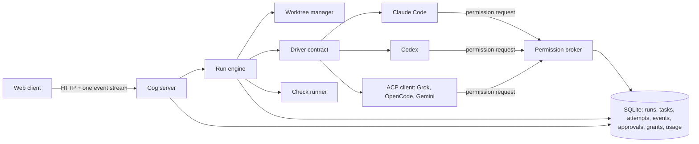
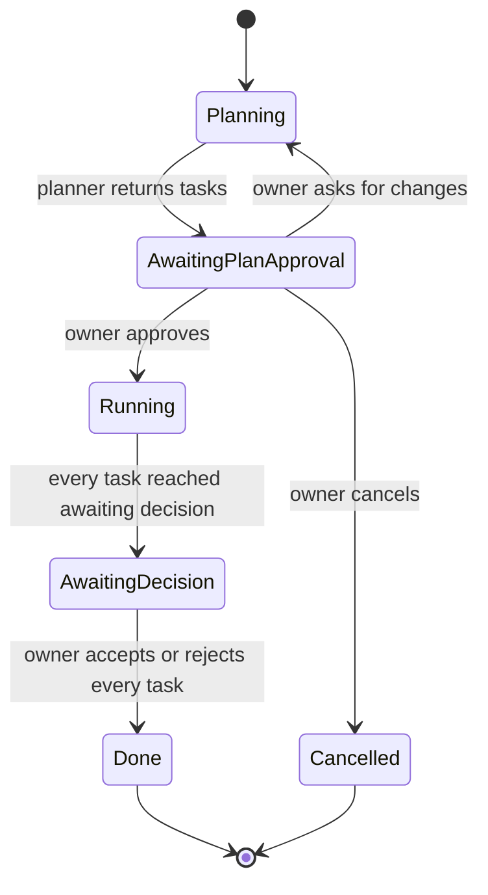
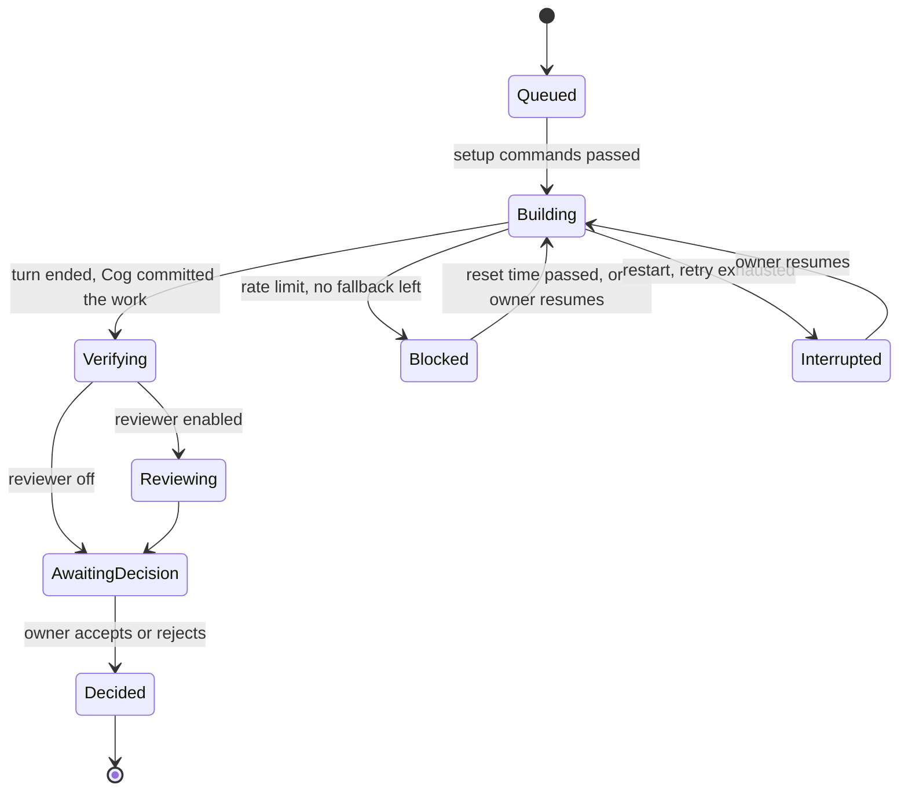

# Cog Core Factory - Plan

## Goal Capsule

- **Objective:** A person with several paid AI coding subscriptions can hand Cog a piece of software work in the evening and find a verified branch, its diff, and the evidence waiting for review, without having driven any coding tool by hand.
- **Means:** Cog's own small codebase drives the coding CLIs the person already uses, one git worktree per task, through a fixed line of stations (KTD1, KTD3, KTD7).
- **Authority:** The Product Contract governs behavior. Key Technical Decisions govern mechanism inside the requirements they cite. A unit overrides neither.
- **Stop conditions:** Stop and ask if a driver cannot be built without storing subscription credentials (R8), or if a requirement can only be met by copying from OpenMausBot's `enterprise/` directory.
- **Execution profile:** Several small pull requests, one per implementation unit, merged in the order under Implementation Units. U1 has no dependency on the others.
- **Who ships:** The implementer finishes each unit and opens its pull request. The owner reviews and merges.

---

## Product Contract

### Summary

Cog is a self-hosted software factory for one power user. Work enters as a prompt or a markdown spec against a local git repository. A planner agent turns it into a task list the owner approves. Implementer agents build each task in its own git worktree. A verify station runs the project's checks, and an optional reviewer on a different model than the implementer critiques the diff. The run ends with a branch, a diff summary, and evidence for the owner to accept or reject.

This plan covers the core app only: the pieces OpenMausBot provides that Cog needs (driving existing CLIs, approvals, persistence, a web client) plus the thinnest factory line on top. It opens with a clickable wireframe of the whole concept.

### Problem Frame

The owner pays monthly for Claude, Grok, Gemini and ChatGPT tiers that sit idle much of the time. Each coding agent that uses them (Claude Code, Codex, Grok CLI, OpenCode) works alone. Multi-step work means switching tools, orchestrating by hand, and checking results without a structured gate.

Two open-source "Grok Bot alternatives" were studied as possible bases. OpenMausBot (26.5k stars) already drives these CLIs well, but it is a 475k-line monolith built around chat, with no worktrees, task graph, planner, verify station, or pull-request flow. Rakazo (9.4k stars) runs its own agent loop, needs Postgres and five services, and lists "CI system" and "isolated one-off tasks" as non-goals. Neither fits as a base for a factory, and both show which commodity parts are worth learning from.

### Key Decisions

- **Own codebase, inspired by OpenMausBot and Rakazo.** Chosen over forking either. (session-settled: user-directed — chosen over forking OpenMausBot: the owner wants to take inspiration but make it their own.) Governs R16, R18.
- **Core app first.** This plan stops at "branch and diff presented". Intake from GitHub, pull-request creation, task dependencies, and multi-model council stations come in later plans. (session-settled: user-directed — chosen over planning PRD Phase 0 and Phase 1 together: "start with the basics and get the core app done".) Governs R6.
- **The product is named Cog.** (session-settled: user-directed — chosen over Gantry, Third Shift, Redline and others: the owner wanted a short, soft name in the style of Dot and Muse.)
- **Drive existing CLIs, do not replace them.** From the PRD's non-goals. Governs R7, R8.
- **A person approves before anything leaves the machine.** From the PRD. In this plan Cog itself pushes and posts nothing; each CLI still sends prompts and code to its model provider under the owner's login. Governs R6, R10.

### Requirements

**Runs**

- R1. The owner can start a run from a freeform prompt or a markdown spec file, against a local git repository they choose.
- R2. A planner agent produces a task list with acceptance criteria per task. The owner can edit it and must approve it before any build starts.
- R3. Each task is built in its own git worktree on its own branch. The owner's checkout and current branch are never modified.
- R4. After a task is built, Cog runs the repository's configured check commands in that worktree and stores their output as evidence on the task.
- R5. The owner can turn on a reviewer for a run. The reviewer runs on a different model than the implementer, on a different driver when one is available, and attaches its critique of the diff as evidence.
- R6. A run ends by presenting each task's branch, diff summary and evidence. The owner records accept or reject. Cog pushes nothing and opens no pull request in this version.

**Models and subscriptions**

- R7. Each role (planner, implementer, reviewer) is assigned a driver and model in configuration, changeable per run.
- R8. Drivers use the login the owner already has in each CLI. Cog never asks for, reads, or stores subscription credentials, and never causes a subscription session to be billed as metered API use.
- R9. When a driver reports a rate limit, the role falls back to the next driver configured for it, and the run records the switch.

**Control**

- R10. When an agent needs permission for an action, the action pauses as an approval card the owner answers in the web client. A pending approval waits until answered and survives a restart.
- R11. After the owner approves the same kind of action for the same role a configured number of times, the card offers standing permission. Standing permissions are narrow, listed, and revocable. A fixed list of dangerous actions is never eligible.
- R12. Every approval decision and every action that ran on standing permission is recorded in an append-only log.

**Visibility**

- R13. A dashboard shows runs grouped by station, pending approvals, and tokens and cost per run and per model. Each cost is marked as reported by the CLI, estimated, or covered by subscription.
- R14. The owner can watch each task's transcript live and read it afterward.

**Resilience and setup**

- R15. After Cog restarts, finished tasks are not repeated. A task that was mid-turn is retried once and otherwise marked interrupted for the owner to resume.
- R16. A technical user reaches a first completed run within 15 minutes of cloning, with no Docker, database server, or external account beyond the CLIs already installed.

**Wireframe**

- R17. A clickable wireframe of every screen exists before any screen is wired to real data, and it becomes the client's shell.
- R18. Any file copied from another project keeps its licence notice, and Cog's `NOTICE` names the source.

### Key Flows

- **F1. A run, end to end.** Owner starts a run (R1). Planner proposes tasks. Owner edits and approves (R2). Each task builds in a worktree (R3), pausing for approvals as needed (R10). Checks run (R4). The reviewer runs when enabled (R5). The owner accepts or rejects each task (R6).
- **F2. An approval.** An agent asks to run a command. A card appears on every screen. The owner allows once, allows as a standing permission when offered (R11), or declines. The agent continues or is told it was declined. The decision is logged (R12).
- **F3. A restart mid-run.** Cog stops while a task is building. On start, finished tasks stay finished, the interrupted task is retried once (R15), and pending approvals reappear (R10).

### Acceptance Examples

- **AE1. Plan gate.** Covers R2. Given a run whose planner returned three tasks, when the owner deletes one and approves, then exactly two worktrees are created.
- **AE2. Checkout untouched.** Covers R3. Given the owner has uncommitted changes on `main`, when a run completes, then `git status` in their checkout shows the same changes and the same branch.
- **AE3. Failing checks.** Covers R4, R6. Given a task whose tests fail, when the run ends, then the task is shown as failed verification with the test output attached, and it can still be accepted or rejected.
- **AE4. Rate limit.** Covers R9. Given the implementer role lists Claude Code then Codex, when Claude Code reports a rate limit mid-task, then the task continues on Codex in the same worktree and the run shows the switch.
- **AE5. Standing permission.** Covers R11. Given the owner has approved "run `npm test` in this repository" for the implementer three times, when the fourth request arrives, then the card offers standing permission, and once granted the fifth request runs without a card and appears in the log.
- **AE6. Never eligible.** Covers R11. Given a request to run `rm -rf` outside the worktree or `git push --force`, when it arrives, then it always shows a card with no standing-permission option, whatever was granted before.
- **AE7. Subscription stays a subscription.** Covers R8. Given `ANTHROPIC_API_KEY` is set in the shell that started Cog, when the Claude Code driver starts a turn, then the child process does not receive that variable.

### Success Criteria

- The owner completes a real task on one of their own repositories and accepts the branch without having opened a coding CLI.
- The owner can tell from the dashboard alone which subscriptions did work this week and which sat idle.

### Scope Boundaries

**Deferred to Follow-Up Work**

- Intake from GitHub Issues, Linear and Slack.
- Pushing branches and opening pull requests, with the outward-action ledger that makes a restart unable to open a second one.
- Task dependencies and parallel builds. The schema carries a dependency field from the start (KTD8).
- Multi-model council stations: several models critique the plan before build, or review the diff together. Botdeck's council in `../botdeck/src/council.ts` is the reference.
- Direct API-key and local-model drivers. Botdeck's adapters in `../botdeck/src/providers/` are the reference.
- Docker or VM sandboxes as an opt-in isolation level.
- Phone access and chat connectors.
- Enterprise foundations from the PRD's Phase 2: SSO, SCIM, multi-tenancy, policy hooks, compliance documents.

**Considered and not built**

- **Tainting runs that read outside text.** Rakazo marks a run as tainted once untrusted text enters and reviews more of its actions. Every input in this plan is typed by the owner. This changes when GitHub issue intake arrives.
- **Timeouts on approvals.** Botdeck denied after ten minutes. A factory that works overnight must wait, so approvals have no timeout (R10).
- **A general chat with bots.** Cog has runs, not conversations. Botdeck keeps that role if the owner wants it.

**Outside this product's identity**

- A fully autonomous factory with no human review.
- Replacing the coding CLIs with Cog's own agent loop.

### Open Questions

- **Nexvyn UI licence (deferred, does not block U2 to U9).** GitHub reports no standard licence for `Nexvyn/Nexvyn-ui`, and the site states none. U1 reads the repository's licence file first. If it forbids use in an Apache-2.0 project, U1 uses plain shadcn components and treats Nexvyn as a visual reference only.
- **Phone access (owner decision, blocks U8 only).** The owner uses a phone much of the time, but this plan's server answers only the machine it runs on, and phone access is deferred. Either phone access to the dashboard and approvals joins this plan, with a stated way to reach the server such as a private network and a login, or U1 treats phone width as a layout check only. Until decided, U1 builds responsive layouts and U8 stays local-only.
- **Unattended runs (owner decision, does not block U1 to U6).** The Objective describes handing work over in the evening, but agents ask before every action except edits in their worktree, and approvals wait without limit, so a run left alone will usually stop at its first command. Either the owner pre-approves a list of commands per repository when starting a run, with an acceptance example for a run that finishes with nobody answering, or the Objective is reworded to an attended run for this version.
- **Which second CLI comes first (owner decision, blocks U5 only).** Only Claude Code is installed. U5 as written builds Codex and three ACP CLIs against fakes written from documentation. Naming the one the owner will install and sign in to first lets U5 record a real transcript and run a real smoke test for it, and move the others to follow-up work.
- **Provider terms for unattended CLI use (owner decision, does not block).** Cog drives each vendor's official CLI in its documented headless mode with the owner's own login. Whether a consumer subscription permits unattended overnight use is a terms question per provider that research did not settle. Rakazo's documentation flags a different mechanism, in-app "Sign in with Claude", as prohibited by Anthropic. The owner should confirm for each subscription before leaving runs unattended. A related unknown is billing: whether a provider counts headless CLI turns against the same plan allowance as interactive use was not verified, and R8 depends on it.

### Sources

- Product requirements: the owner's "OpenMaus Factory" PRD, version 1.0, November 2026.
- OpenMausBot study: `milind-soni/OpenMausBot` at the default branch on 2026-11-21. Apache-2.0 except `enterprise/`. Its `NOTICE` records that much of the driver layer is adapted from T3 Code under MIT.
- Rakazo study: `elie222/rakazo` at the default branch on 2026-11-21. Apache-2.0 throughout.
- Prior prototype: `../botdeck` in this workspace (approval ladder, usage ledger, zero-dependency server, tests against fake providers).

---

## Planning Contract

### Key Technical Decisions

- KTD1. **New repository, Apache-2.0, written from the contracts and not copied wholesale.** OpenMausBot's driver layer is 39k lines importing 213 paths outside itself, so it cannot be lifted as a module. Cog re-types the contract and may copy only small self-contained files, each recorded in `NOTICE` (R18). Apache-2.0 matches both sources. Files from OpenMausBot's driver layer that its `NOTICE` marks as adapted from T3 Code also keep that MIT notice, so the implementer checks each copy candidate against that `NOTICE` first. Instantiates the "own codebase" Key Decision.
- KTD2. **TypeScript on Node 24 or later, run directly with no server build step.** One process, `node:http`, one server-sent-events stream to the client, `node:sqlite` in a single database file under `~/.cog`. This is OpenMausBot's process model without its split across two databases and loose JSON files, and it is what Botdeck already runs on. It is what makes R16 reachable; Rakazo's Postgres and five services are the counter-example.
- KTD3. **Drivers are stdio subprocesses speaking each CLI's structured headless protocol, behind one adapter contract.** Claude Code uses stream-json in and out with one retained process per task and `--resume`. Codex uses its app-server JSON-RPC. Grok CLI, OpenCode and Gemini share one Agent Client Protocol client with a small support object per CLI. The contract has `sendTurn`, `interruptTurn`, `respondToRequest`, `onEvent`, an opaque resume cursor, and capability flags, and every driver emits one normalized event union. No pty and no vendor agent SDK. This is OpenMausBot's verified design and the one Rakazo lacks: Rakazo reduces the CLI to a one-turn model endpoint, which discards the agent the subscription pays for.
- KTD4. **Subscription safety is enforced in the driver's process launch.** The child environment is built from an allowlist, and provider API-key variables are removed before spawn (R8, AE7). MCP configuration is isolated with `--strict-mcp-config`, and the Claude Code driver launches with `--setting-sources project`, so a run inherits none of the owner's personal MCP servers, permission allow rules, hooks or plugins while the repository's own instructions still load. Without this the CLI applies the owner's own allow rules before it ever calls the broker. Cog implements no in-app OAuth and calls no unofficial usage endpoints. Rakazo's `providers/cli-model/claude-code/cli.ts` (301 lines, Node built-ins only) is the candidate file to lift for the allowlist, process-group kill, and version and login probe.
- KTD5. **Tool-level approvals go through a permission broker.** For Claude Code, `--permission-prompt-tool` points at a small stdio MCP proxy that forwards over a unix socket to an in-process broker. The broker writes the approval row, emits the event, and blocks until `respondToRequest`. Codex approvals arrive as server-to-client requests and ACP ones as permission requests, and both map to the same broker. Any broker failure denies. The implementer's mode lets it edit inside its worktree and asks for everything else. The planner and reviewer run read-only: write and edit tools are disallowed at launch and every command asks. The planner works in a detached worktree of the base commit that is removed once the plan is approved, so it never runs in the owner's checkout (R3). The reviewer works in the task worktree. The floor list is also passed to the CLI as ask rules, so an allow rule in the repository's project settings cannot run a floor action without the broker.
- KTD6. **Standing permissions are narrow grants plus a safety floor, earned per role.** A grant is an exact command plus the source repository plus the working directory relative to the worktree root, or a named tool, scoped to a role. Approval counts use the same key, so approvals earned in one task apply to later tasks and runs on that repository (AE5). It is offered after the configured number of approvals (R11) and stored as a row. A never-list overrides every grant (AE6). The ladder logic comes from `../botdeck/src/autonomy.ts`; the grant shape and the floor come from OpenMausBot's `command-allowlist.ts` and `approval-mode.ts`.
- KTD7. **Isolation is one git worktree per task, on the host.** Worktrees live under `~/.cog/worktrees/<run>/<task>` on branch `cog/<run>/<task>`, created from the repository's current `HEAD` commit. The agent's working directory is the worktree. Neither studied project has worktrees, so this is new code. When an implementer's turn ends, and before checks run, Cog itself stages and commits everything in the worktree to the task branch and records the commit on the task. The agent is never relied on to commit. The diff summary is base commit to branch head, and a worktree is removed only when it is clean. Setup commands configured per repository, such as a dependency install, run in each new worktree before the build, because a fresh worktree holds only tracked files. Check commands (R4) run on the host in the worktree, which is the same trust the owner already gives their own test suite.
- KTD8. **Runs and tasks are two row-driven state machines, with attempts under tasks.** The run row carries planning, awaiting plan approval, running, awaiting decision, done and cancelled. Each task row carries its own station: queued, building, verifying, reviewing, awaiting decision, blocked, interrupted, decided. Tasks go through build, verify and review one at a time. The station a run shows on the board is that of its earliest unfinished task. Each task carries a `depends_on` field that this plan always leaves empty, so the later task-graph plan needs no migration. State changes and their events are written in one transaction. This borrows OpenMausBot's assignment record with its restart policy and harness-recorded evidence.
- KTD9. **Restart recovery reconciles from the database.** CLI processes do not survive a restart. On start, a task whose attempt was mid-turn is re-driven once using the stored resume cursor and otherwise marked interrupted (R15). A task that was blocked on a pending approval is parked instead: it is not re-driven and keeps its retry. Its approval row stays pending. When the owner answers, Cog re-drives the task from its resume cursor and applies the stored answer once to the first matching request from the new process. A request that does not match raises a new card and closes the old row as superseded (R10). This is OpenMausBot's policy with the "never rerun after an outward action" clause left for the pull-request plan.
- KTD10. **Usage is an append-only ledger with a cost kind.** One row per turn: tokens, driver, model, run, task, and cost as `reported`, `estimated`, or `subscription` with a nullable amount (R13). Claude Code and Codex report usage and rate-limit events in-band, so no extra calls are needed. The cost kind comes from the driver's billing kind, which the login probe sets from the CLI's own status output without reading any credential. It never comes from whether the CLI printed a cost: Claude Code prints a running dollar total on subscription logins too. `reported` applies only to a metered login, and its amount is the growth in the CLI's running total since the previous turn.
- KTD11. **Routing is configuration, with ordered fallbacks.** Each role lists drivers in preference order. A normalized rate-limit event advances the task to the next one in the same worktree (R9, AE4). The fallback driver starts a fresh session with a handoff prompt: the task, its acceptance criteria, a note that an earlier attempt was cut off, and the worktree's current diff summary. Resume cursors are never passed between drivers. With no fallback left, the task is blocked with the reset time when the CLI gave one, and the engine resumes it on its first driver once that time passes, including after a restart. Without a reset time it waits for the owner. There is no automatic choice by task type in this plan.
- KTD12. **The client is React with Vite, Tailwind and shadcn components, with Nexvyn UI for the shell where its licence allows.** The owner named Nexvyn UI. It installs through the shadcn registry and supplies sidebars, an AI input, and form controls. It has no tables, cards, charts or chat blocks, so those come from plain shadcn. The wireframe in U1 is this same app on mock data, so it is not thrown away (R17). The built client is static files served by the Cog process.
- KTD13. **Drivers are tested against fake CLIs.** Each driver has a small script that speaks its protocol from a recorded transcript. Only Claude Code is installed on the owner's machine today, so Codex and ACP drivers are proven by fakes until those CLIs are installed. This is OpenMausBot's testing pattern and Botdeck's mock-provider pattern.

### High-Level Technical Design

Components and the direction of calls:



Run states and gates:



Task stations, one task at a time while the run is Running:



### Output Structure

```text
cog/
  NOTICE
  cog.config.json
  src/
    server.ts
    store/            schema, migrations, atomic writes
    drivers/          contract.ts, events.ts, launch.ts, claude-code.ts, codex.ts, acp/
    approvals/        broker.ts, permission-proxy.ts, grants.ts, floor.ts
    worktrees.ts
    engine/           run.ts, stations.ts, recover.ts, roles.ts
    checks.ts
    usage.ts
    api/              routes.ts, stream.ts
  web/                Vite + React client; mock data lives in web/src/mock/
  test/
    fakes/            fake-claude.ts, fake-codex.ts, fake-acp.ts, transcripts/
```

### Assumptions

- The owner's repositories are local git repositories with at least one commit.
- Check commands and setup commands are supplied per repository in configuration. Cog does not detect them.
- One owner uses one Cog instance. Requests come only from the same machine, and the server refuses others, as Botdeck's does.

### Risks

- **CLI protocols change under us.** Each vendor ships often. Mitigation: one small driver per protocol, capability flags, a version probe at startup that warns on an untested version, and recorded transcripts that make a break show up as a failing test.
- **Verification gives false confidence.** Passing checks do not mean the task is right. Mitigation: acceptance is always the owner's act (R6), and failed checks are shown, not hidden (AE3).
- **Checks run code the agent just wrote.** Edits in the worktree need no approval, and the check station then runs the edited tests and scripts on the host before the owner has seen the diff. This plan accepts that for the owner's own repositories and names it here. A sandbox for checks is in the deferred isolation work.
- **Tasks cannot build on each other.** Every task branches from the same base commit, so a later task does not see an earlier one's changes until task dependencies land. The planner prompt demands independent tasks (U7).
- **A CLI may not hold a permission request open for hours.** OpenMausBot denies after 15 minutes. U4 measures how long the installed Claude Code keeps a request pending. If it times out, the task takes the same park-and-re-drive path as a restart (KTD9).
- **Parallel agents thrash the machine.** Out of scope here because tasks build one at a time. It returns with the task-graph plan.
- **Provider terms.** See Open Questions.

---

## Implementation Units

### U1. Clickable wireframe of the whole concept

**Goal:** Every screen exists as a navigable client on mock data, so the concept can be judged before backend work.

**Requirements:** R17, and it previews R2, R6, R10, R11, R13, R14.

**Dependencies:** None.

**Files:** `NOTICE`, `web/package.json`, `web/index.html`, `web/src/main.tsx`, `web/src/app/` (shell and routes), `web/src/screens/` (runs board, run detail, new run, approvals, usage, settings), `web/src/mock/`, `web/src/components/ui/` (installed shadcn and Nexvyn components), `web/src/screens/screens.test.tsx`.

**Approach:**

1. Read the licence file in `Nexvyn/Nexvyn-ui`, create `NOTICE` with the outcome, or fall back to plain shadcn (Open Questions).
2. Build the shell: a Nexvyn sidebar, and an approval tray visible on every screen.
3. Build six screens on mock data: runs board with one column per station, run detail (task list, live transcript, diff, evidence, accept and reject), new run (prompt or spec, repository, roles, reviewer toggle), approvals and standing permissions with the action log, usage by model and by run, and settings (drivers found, roles and fallbacks, check commands).
4. Run detail has a plan-approval mode: tasks with editable title and acceptance criteria, add and delete, and Approve, Request changes with a feedback box, and Cancel. It also shows an interrupted task with Resume, and a blocked task naming the driver and the time it will retry.
5. The approval card shows the command or tool, directory, role, task, run, the agent's stated reason, and how many approvals count toward standing permission. Granting standing permission is a separate confirmed action that states the grant's scope. The browser tab title carries the pending count.
6. Run detail shows changed files with line counts, each expandable to a unified diff in a scrolling monospace block. After Accept it shows the branch name and worktree path with copy buttons and a note that nothing was merged or pushed. Reject asks, with a confirmation, whether to keep or discard the branch.
7. Every screen has empty, loading and error content. The empty runs board links to New run, and to Settings when no driver is available. A banner shows when the event stream is disconnected.
8. The landing view orders runs that need the owner first, then running work, then finished runs collapsed.
9. Below a phone breakpoint the board is one column with a station selector, the approval tray is a bottom sheet, and touch targets are at least 44px. New approvals are announced through a live region, actions are keyboard reachable, and failed state and cost kind carry text or an icon as well as colour.
10. Follow the `dataviz` skill's rules for the usage charts, as Botdeck's dashboard did.

**Patterns to follow:** `../botdeck/public/app.js` for the approval tray and the usage chart rules.

**Test scenarios:**

- Each of the six routes renders from mock data without console errors.
- With two mock approvals pending, the tray shows both on every route and the sidebar shows a count of two.
- A mock approval flagged as eligible shows the standing-permission button; one flagged as never eligible does not.
- A mock task with failed checks shows as failed and still offers accept and reject.
- A mock run awaiting plan approval lets a task be edited, deleted and added, and offers Approve, Request changes and Cancel.
- Mock interrupted and blocked tasks show Resume and the retry time.
- With no runs and no available driver, the board shows the first-run empty state linking to Settings.
- A new mock approval is announced in the live region, and a failed task is marked with text as well as colour.
- Rejecting a mock task asks whether to keep or discard the branch before anything changes.

**Verification:** The owner can click from starting a run to accepting a task using only the wireframe, in light and dark mode, at phone and desktop widths.

### U2. Repository scaffold and store

**Goal:** A running Cog process with configuration and one database that later units write to.

**Requirements:** R12, R16, R18.

**Dependencies:** None. It extends the `NOTICE` that U1 creates, or creates it if U2 lands first.

**Files:** `package.json`, `tsconfig.json`, `LICENSE`, `NOTICE`, `cog.config.json`, `src/config.ts`, `src/store/db.ts`, `src/store/schema.ts`, `src/store/atomic.ts`, `test/store.test.ts`.

**Approach:** Create the tables in KTD8 and KTD10 plus approvals, grants and an append-only action log, with a schema version and forward-only migrations. Keep everything under `~/.cog`, overridable for tests. The action log has no update or delete path in code.

**Patterns to follow:** `../botdeck/src/db.ts` and `../botdeck/src/config.ts`. OpenMausBot's `atomic.ts` is a candidate to copy.

**Test scenarios:**

- A fresh data directory gets the current schema; opening it again changes nothing.
- A database at an older schema version is migrated forward and keeps its rows.
- Appending to the action log succeeds, and the store exposes no way to change or remove an entry.
- A local config file overrides defaults, and an unknown driver name in a role is rejected at load with a message naming the role.

**Verification:** `npm start` on a clean machine creates `~/.cog` and serves a health response with no other setup.

### U3. Driver contract, fake CLI harness, and the Claude Code driver

**Goal:** Cog can run a turn in Claude Code, stream normalized events, resume a session, and interrupt it.

**Requirements:** R7, R8, R14.

**Dependencies:** U2.

**Files:** `src/drivers/contract.ts`, `src/drivers/events.ts`, `src/drivers/launch.ts`, `src/drivers/claude-code.ts`, `test/fakes/fake-claude.ts`, `test/fakes/transcripts/`, `test/drivers/claude-code.test.ts`, `test/drivers/launch.test.ts`.

**Approach:** Define the contract and event union from KTD3. Put the environment allowlist, API-key removal, MCP and settings isolation, process-group kill, and version and login probe in `launch.ts` (KTD4). The probe also sets the driver's billing kind (KTD10) and checks the CLI version against a table of the flags each supported version needs, because flag names already differ between versions. Persist every event to the store as it arrives so transcripts need no second path (R14).

**Execution note:** Record one real Claude Code transcript first and build the fake from it, so the driver is written against the real wire shape.

**Patterns to follow:** OpenMausBot's `server/contracts.ts` and `packages/phone-protocol/src/runtime-events.ts` for the shapes to re-type. Rakazo's `providers/cli-model/claude-code/cli.ts` for launch.

**Test scenarios:**

- A turn against the fake yields text, tool-call, tool-result, usage and turn-end events in order.
- Covers AE7. With `ANTHROPIC_API_KEY` set in the parent, the fake reports that it did not receive it.
- A second turn passes the stored resume cursor, and the fake confirms it resumed the same session.
- Interrupting mid-turn ends the turn with an interrupted event and leaves no child process running.
- A malformed line from the CLI produces an error event and does not crash the driver.
- When the CLI is missing or logged out, the probe reports which, and no turn starts.
- A rate-limit message from the fake becomes one normalized rate-limit event carrying the reset time when the CLI gave one.
- The launch arguments exclude user and local setting sources and personal MCP servers.
- A CLI version missing a required flag is reported as unsupported, and no turn starts.

**Verification:** A turn against the real installed Claude Code completes and appears in the database with its usage row.

### U4. Permission broker, approvals, and standing permissions

**Goal:** Agent actions that need permission pause durably, and the owner can earn them down to standing grants.

**Requirements:** R10, R11, R12.

**Dependencies:** U3.

**Files:** `src/approvals/broker.ts`, `src/approvals/permission-proxy.ts`, `src/approvals/grants.ts`, `src/approvals/floor.ts`, `test/approvals/broker.test.ts`, `test/approvals/grants.test.ts`, `test/approvals/floor.test.ts`.

**Approach:** Implement KTD5 and KTD6. The gate decision is a pure function of the request, the grants and the floor, returning ask, allow or deny. Wire it to the Claude Code driver's permission prompt tool.

**Patterns to follow:** `../botdeck/src/autonomy.ts` for the ladder. OpenMausBot's `server/permission-proxy.ts`, `command-allowlist.ts` and `approval-mode.ts` are candidates to copy. Rakazo's `planActionGate` in `packages/core/src/runs/action-approval.ts` for the pure-function shape.

**Test scenarios:**

- An edit inside the task's worktree is allowed with no card.
- A command request creates a pending approval; approving it unblocks the fake CLI, and declining returns a declined result to it.
- Covers AE5. The third approval of the same command and directory for a role marks the next card eligible; granting makes the following request run without a card and writes a log entry.
- Covers AE6. A floor-listed request is never eligible and always asks, even when an exact grant exists.
- The same command in a different repository, a different worktree-relative directory, or for a different role does not match the grant.
- A grant earned in one task's worktree applies in a later run's worktree of the same repository.
- A floor-listed command still reaches the broker when the repository's project settings allow it.
- A planner or reviewer edit attempt is refused.
- Revoking a grant makes the next request ask again.
- If the broker socket is unavailable, the proxy answers deny.
- A pending approval is still pending after the store is closed and reopened.

**Verification:** A real Claude Code turn that tries to run a shell command stops until the approval is answered through the broker, including a command that the owner's personal Claude Code settings allow. The time the real CLI keeps a request pending is measured and recorded.

### U5. Codex driver and the shared ACP client

**Goal:** The same contract works for Codex and for ACP-speaking CLIs, so roles can be spread across subscriptions.

**Requirements:** R7, R8, R10.

**Dependencies:** U3, U4.

**Files:** `src/drivers/codex.ts`, `src/drivers/acp/client.ts`, `src/drivers/acp/support.ts`, `test/fakes/fake-codex.ts`, `test/fakes/fake-acp.ts`, `test/drivers/codex.test.ts`, `test/drivers/acp.test.ts`, `test/drivers/conformance.test.ts`.

**Approach:** Codex speaks app-server JSON-RPC, with approvals as server-to-client requests routed to the broker. The ACP client is written once, with support entries for Grok CLI, OpenCode and Gemini that name the launch command and capability flags. One conformance suite runs the same scenarios against every driver through its fake.

**Execution note:** None of these CLIs is installed on the owner's machine. Build against fakes from the documented protocols, and flag each driver as unverified against the real CLI until it has been run once.

**Patterns to follow:** OpenMausBot's Codex driver and `server/drivers/acp/core.ts` for protocol handling. Rakazo's single conformance test across providers.

**Test scenarios:**

- The conformance suite (turn, resume, interrupt, permission request, usage, rate limit, malformed input) passes for the Claude Code, Codex and ACP drivers.
- A Codex server-to-client approval request creates a pending approval, and the answer is returned as the JSON-RPC response.
- An ACP CLI that does not advertise session resume is reported as not resumable through its capability flag.
- A support entry whose command is not installed is listed as unavailable and cannot be assigned to a role.

**Verification:** Settings lists each driver as available, unavailable, or unverified, matching what is installed.

### U6. Worktree manager

**Goal:** Each task gets a clean, separate working copy, and the owner's checkout is never touched.

**Requirements:** R3.

**Dependencies:** U2.

**Files:** `src/worktrees.ts`, `test/worktrees.test.ts`.

**Approach:** Implement KTD7: create, run setup commands, commit the work, describe (branch, base commit, diff summary), and remove. Removal deletes the worktree and keeps the branch unless the owner rejected the task and chose to discard it.

**Test scenarios:**

- Covers AE2. With uncommitted changes and a checked-out branch in the source repository, creating and removing a worktree leaves `git status` and the current branch unchanged.
- Two tasks of one run get two worktrees and two branches from the same base commit.
- A branch name collision from an earlier run is resolved with a new name and never by reusing or resetting the old branch.
- A path that is not a git repository, or a repository with no commits, is rejected with a clear message before any run row is created.
- After a build that left modified and untracked files, the branch head contains them, and removing the worktree loses nothing.
- The diff summary lists changed files and line counts from the base commit to the branch head.
- A failing setup command is reported with its output before any agent turn starts.

**Verification:** After a full run, `git worktree list` in the source repository shows only the worktrees of tasks still awaiting a decision.

### U7. Run engine: stations, roles, checks, and recovery

**Goal:** A run moves through the stations on its own, stopping only at the gates and for approvals.

**Requirements:** R1, R2, R4, R5, R6, R9, R15.

**Dependencies:** U3, U4, U6. U5 for the reviewer and fallback scenarios against a second driver.

**Files:** `src/engine/run.ts`, `src/engine/stations.ts`, `src/engine/roles.ts`, `src/engine/recover.ts`, `src/checks.ts`, `test/engine/run.test.ts`, `test/engine/recover.test.ts`, `test/checks.test.ts`.

**Approach:**

1. Implement the state machine in the High-Level Technical Design, per KTD8.
2. The planner role runs read-only in its own detached worktree (KTD5) and is told to produce tasks that do not depend on each other. It returns the task list as structured output that Cog validates. An invalid plan is sent back to the planner once, then surfaced to the owner.
3. The implementer role receives the task, its acceptance criteria and the worktree.
4. Checks run per KTD7 with a per-command time limit, and output is stored as evidence.
5. The reviewer role receives the diff and the evidence, runs read-only, and must be on a different model than the implementer (R5).
6. Fallback follows KTD11. Recovery follows KTD9.

**Test scenarios:**

- A run against fakes goes from prompt to awaiting decision with one task, its evidence and its diff summary.
- Covers AE1. The owner removes one of three planned tasks and approves; two tasks are built.
- The owner asks for plan changes; the planner is called again with the feedback, and no worktree exists yet.
- Covers AE3. A failing check marks the task as failed verification with output attached, and the run still reaches awaiting decision.
- A check that exceeds its time limit is killed and recorded as timed out.
- Covers AE4. A rate-limit event mid-build moves the task to the next configured driver in the same worktree, and the switch is recorded.
- With no fallback left, the task is blocked with the reset time, and it resumes on its own once that time passes, including across a restart.
- The fallback driver receives the handoff prompt and no resume cursor from the first driver.
- Enabling the reviewer with the same model as the implementer is rejected when the run is created.
- A planner edit attempt is refused, and the source checkout is unchanged after planning.
- A run with two tasks builds, verifies and reviews the first before starting the second.
- Recovery: a finished task is not rebuilt; a task that was mid-turn is retried once from its resume cursor; a second interruption marks it interrupted.
- A run in awaiting plan approval is still there after a restart.
- Recovery with a pending approval: the task is parked and keeps its retry; answering the card re-drives it, and it continues with no second card.
- A markdown spec file is accepted as the run's input, and a missing file is rejected before the run is created.

**Verification:** A real run on a repository with installed dependencies and a setup command, with Claude Code as planner and implementer, ends at awaiting decision with a committed branch whose checks passed.

### U8. API, event stream, and wiring the client

**Goal:** The wireframe becomes the working client.

**Requirements:** R1, R2, R6, R10, R13, R14.

**Dependencies:** U1, U7.

**Files:** `README.md`, `src/server.ts`, `src/api/routes.ts`, `src/api/stream.ts`, `web/src/api/`, `web/src/screens/` (replace mock data), `test/api/routes.test.ts`, `test/api/stream.test.ts`.

**Approach:** Routes for runs, plan edits and approval, task decisions, approvals, grants, settings, transcripts, and a task's per-file diff. Write `README.md` covering install, first run, role configuration, and setup and check commands. One event stream carries change signals, and the client refetches what changed. The server binds to the loopback address and refuses foreign `Host` and `Origin` headers. Mock data stays available behind a demo flag.

**Patterns to follow:** `../botdeck/src/server.ts` for the host and origin checks and the stream.

**Test scenarios:**

- Starting a run through the API returns its id, and the stream announces each station change in order.
- Answering an approval through the API unblocks the waiting agent in an engine running against fakes.
- A client that connects after events were emitted can fetch the full transcript and then receive only new events.
- A request with a foreign `Origin`, or a non-JSON body on a write route, is refused.
- Editing the plan after it was approved is refused.
- Accepting or rejecting a task that is not awaiting a decision is refused.

**Verification:** The click-through from U1 works against a real run, with the transcript updating live, and a new user can follow `README.md` to a first run.

### U9. Usage ledger and the dashboard

**Goal:** The owner can see which subscriptions are doing work and what metered use costs.

**Requirements:** R13.

**Dependencies:** U3, U8.

**Files:** `src/usage.ts`, `src/api/routes.ts`, `web/src/screens/usage.tsx`, `web/src/screens/runs-board.tsx`, `test/usage.test.ts`.

**Approach:** Implement KTD10. Aggregate by day, driver, model and run. Never add subscription-covered turns into a dollar total; show them as tokens and turn counts.

**Patterns to follow:** `../botdeck/src/dashboard.ts` and `../botdeck/public/app.js` for bucketing by local day and for the chart.

**Test scenarios:**

- A turn on a metered login whose CLI reported a cost is stored as reported, with the growth in the running total as its amount.
- A turn on a subscription login is stored as subscription with no amount, even when the CLI printed a cost, and is excluded from every dollar total.
- A turn with tokens and no reported cost, on a model with a configured price, is stored as estimated.
- A turn on a model with no configured price is counted in tokens and listed as unpriced, not as zero dollars.
- Totals per run equal the sum of that run's task totals.
- A week with activity on one driver and none on another shows the idle driver with zero turns, not missing.

**Verification:** After two real runs on different days, the dashboard's per-model figures match the rows in the ledger.

---

## Verification Contract

| Gate | Command or check | Applies to |
|---|---|---|
| Types | `npm run typecheck` | every unit |
| Server tests | `npm test` | U2 to U9 |
| Client tests | `npm test --prefix web` | U1, U8, U9 |
| Client build | `npm run build --prefix web` | U1, U8, U9 |
| Driver conformance | `test/drivers/conformance.test.ts` passes for every driver | U5 |
| Real-CLI smoke | One run on a sample repository with the installed Claude Code reaches awaiting decision | U7, U8 |
| Checkout safety | AE2 holds on the owner's real repository | U6, U7 |

Tests against fakes prove protocol handling and engine logic. They do not prove that a real CLI still speaks the recorded protocol, which is what the real-CLI smoke is for. Codex and ACP drivers have no real-CLI smoke until those CLIs are installed, and they stay labeled unverified.

## Definition of Done

- Every requirement R1 to R18 is met, and every acceptance example AE1 to AE7 is covered by a passing test.
- All gates in the Verification Contract pass.
- A first run from a fresh clone completes within the 15 minutes in R16, timed once on the owner's machine.
- `NOTICE` lists every copied file with its source and licence, and nothing originates from OpenMausBot's `enterprise/` directory.
- `README.md` explains install, first run, role configuration and check commands.
- Code from abandoned approaches is removed from the diff.
- Each unit is done when its test scenarios pass and its Verification line holds.
